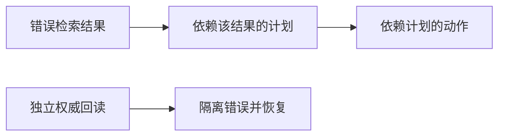

# 第 12 章：异常处理和恢复

> 来源：<https://adp.xindoo.xyz/chapters/>  
> 整理语言：中文  
> 整理更新：2026-10-02；含原理、教学例子与自检。示例不是生产部署验收。

## 本章定位

识别执行失败、工具错误与环境异常，并通过重试、回退、替代方案等方式恢复。

## 先分清失败类型

临时网络错误可有限重试；参数错误应修参数；鉴权失败应处理身份/权限；业务拒绝需解释原因；状态未知的写操作要先查询执行结果。把所有错误都重试，会造成重复写入、限流加剧和成本浪费。

重试应有限次数、指数退避和抖动，并遵守服务返回的等待信息。长任务保存检查点与任务 ID；事件处理记录去重键，避免相同通知重复触发副作用。

## 具体例子：创建记录后超时

客户端发送“创建条目”，服务器已创建，但响应丢失。此时再次发送相同创建请求可能得到两条记录。可先使用同一个幂等键查状态或重试，由服务保证重复键只产生一个结果；如果服务不支持，就按唯一业务标识回读，无法确认时报告状态未知。

故障切换也要保留模型/模板差异：备用模型能连通，不代表工具调用语义完全相同。恢复后重跑关键校验，而不是直接宣称原任务成功。

## 自检与核对

**问题**：HTTP 超时说明服务器一定没执行吗？

**核对**：不说明。它只说明客户端未及时取得结果。读请求通常可重试，写请求必须结合幂等性和状态核对来恢复。

## 来自《深入理解 AI Agent》的增量吸收

- 异常恢复应覆盖模型调用、工具调用、文件修改、外部服务和长任务执行，而不是只捕获程序异常。
- Coding Agent 的恢复思路包括验证修改结果、重试、重新定位、替代工具/模型以及供应商故障切换。
- 异步 Agent 还需要处理事件重复、超时、乱序、状态丢失和中断恢复。
- 失败轨迹应进入评估与回归集，避免同类故障反复出现。

完整来源：[第 5 章 Coding Agent](../05-来源保全/深入理解%20AI%20Agent/source/book/chapter5.md) · [第 6 章 交互](../05-来源保全/深入理解%20AI%20Agent/source/book/chapter6.md) · [第 7 章 Agent 的评估](../05-来源保全/深入理解%20AI%20Agent/source/book/chapter7.md)

## 用目标、轨迹与真实效果诊断失败

2026-10-09 吸收固定来源 Phase14 第 26 课。程序没抛异常只说明运行路径没有触发相应异常；一个合法 JSON 仍可能选错对象、违反范围、引用错误证据或谎报完成。先记录用户目标、允许对象与动作、预定后置条件，再记录模型提议、工具调用/参数、状态回读和终态。观察到的迹象、已验证的失败与根因假设应分开写。

源教学归纳的五类是幻觉动作、范围漂移、错误级联、上下文丢失与工具误用，源码还另加“成功幻觉”。这些是排查入口，允许一条轨迹有多个标签，并非所有失败的穷尽集合。例如版本错配也会造成失败，即使不在这五标签中。不要把重叠标签计数相加当成 100% 覆盖率。

| 排查入口 | 可观察证据 | 易混淆的良性情况与验证方法 |
| --- | --- | --- |
| 幻觉动作 | 调用不存在或在此 runtime 不可用的工具；声称执行但没有调用/回执 | 固定 `KNOWN_TOOLS` 不等当前授权目录，先核注册版本与可用能力 |
| 范围漂移 | 实际对象/动作不在已授权任务内 | “do not write”含 write 不能当写授权；中文、隐含可逆实施与具体对象须结合任务合同 |
| 错误级联 | 错误值经依赖边进入其他决策、调用或系统 | 错误之后正常重试/独立查询不一定受影响；看数据与控制依赖 |
| 上下文丢失 | 明确约束、先前确认或状态在后续选择中未被保留 | 关键词检测只能报告迹象，不能证明模型内部“忘记”；恢复压缩后的关键约束与状态版本 |
| 工具误用 | 参数类型/语义、额外参数、目标权限或调用时机不合合同 | schema 合法不代表业务正确，核对象 ACL、语义、前置条件与副作用 |
| 成功幻觉 | 宣称完成，但承诺的后置条件未满足或没有足够证据 | 只读任务可无状态变化；幂等设置已满足目标也可成功，不强制 `changed=True` |

源 detector 是粗签名：`do not` 后取第一个词再查参数，会把 “do not modify src” 提成 modify，而真实写参数只有 src 时漏检；空的 “do not” 会索引异常。参数 key 子集检查漏类型/额外字段/授权；某 error 后任意两次 call 的规则把正常恢复误判级联。维护时给每项增加相似良性负例和边界输入，测漏报/误报；不把 Counter 分布称为真实 trace 聚类。

## MAST：14 个模式的具体含义

这里依据 [MAST v3 Appendix A](https://arxiv.org/html/2503.13657v3#A1) 的定义作简洁中文概括，例子为自写假业务场景。v1 使用 MASFT 名称，v3 使用 MAST；类别为系统设计 5 项、Agent 间失配 6 项、任务验证 3 项，共 14 项。第三类只有 3 项，“每类至少 4 项”的原教学目标应纠正。

| 类别与编号 | 核心含义 | 便于核对的假例子 |
| --- | --- | --- |
| 系统设计 1.1 | 未遵守任务约束/要求 | 只允许汇总公开资料，却加入私人附件内容 |
| 系统设计 1.2 | 未遵守角色职责/边界 | 审查者本应只给意见，却直接覆盖作者文件 |
| 系统设计 1.3 | 无必要重复已经完成的步骤 | 已有有效回执，仍反复创建同一条目 |
| 系统设计 1.4 | 丢失会话历史或回到较早状态 | 最新确认排除 A，恢复后仍按旧候选含 A 执行 |
| 系统设计 1.5 | 未识别应终止条件 | 全部目标通过验收后继续工具循环直到预算耗尽 |
| Agent 间失配 2.1 | 无必要重启对话 | 子任务尚未结束，协调者丢弃已有上下文重新问同一任务 |
| Agent 间失配 2.2 | 信息不清/不全时未澄清便行动 | 缺少应修改的版本却直接改猜测版本 |
| Agent 间失配 2.3 | 偏离原目标 | 任务是修一个 bug，协作逐步转为无关全站重构 |
| Agent 间失配 2.4 | 有重要信息却未传给需要方 | 查询者已知数据过期，却未通知依赖其结论的汇总者 |
| Agent 间失配 2.5 | 未适当考虑其他 Agent 输入 | 审查者给了可复现反例，作者仍按未被反驳的原结论继续 |
| Agent 间失配 2.6 | 所述推理/计划与实际动作不一致 | 说明只会读取，实际发出写请求 |
| 任务验证 3.1 | 目标未满足就过早终止 | 把提交成功当作全部异步任务完成 |
| 任务验证 3.2 | 没验证或验证不完整 | 只检查生成文件存在，未检查内容与链接 |
| 任务验证 3.3 | 验证/交叉核对方式错误 | 用模型自己编造的参考答案核模型输出 |

相同症状可能有不同来源：目标漂移可能是角色约束弱，也可能是消息丢失、压缩损失、模型理解错误。分类不是自动根因裁决。原论文 §4 讨论系统结构与协调/验证的可改进空间，同时承认基础模型能力局限会造成失败；不能教成“所有失败纯设计问题，升级基础模型毫无作用”。标注一致性如 Cohen's κ 反映特定样本与协议下的标注一致，不证明分类涵盖所有失败或推断具有因果效力。

[Agent 幻觉综述 v2 §III-A](https://arxiv.org/html/2509.18970v2) 中 instruction/context 两点是意图理解局限的表现：未适当理解/遵从指令，以及前文上下文的忘记/误用。综述还讨论感知、推理与动作方面，不能把这两点写成全部 Agent 幻觉分类，也不能把 system 与 user 指令层级混成同一种授权。

## 级联半径需要因果图

令有向无环图中的边 $u\to v$ 表示步骤 $v$ 使用步骤 $u$ 的输出或依赖其控制决定。可达后继集合给出**潜在影响范围**；真正影响还需确认错误数据是否被采纳、是否被纠正，以及最后效果。可报告受影响步骤/对象/系统数、持续时间、额外成本与不可逆损失，不能只取时间上晚于错误的行数。



### CPU 实验：潜在级联与后置条件

完整标准库程序用内存 DAG 模拟错误步骤、两个依赖后继和独立恢复。`descendants` 给潜在影响集，`consumed_bad` 是本 fixture 已观察到使用错误输入的步骤；两者分开。图按拓扑顺序构造，拒绝未知/前向依赖，从而不把循环图当 DAG。三个状态例核只读成功、幂等成功和谎报写成功。

```python
from dataclasses import dataclass

@dataclass(frozen=True)
class Step:
    name: str
    parents: tuple[str, ...]
    consumed_bad: bool = False

steps = [Step('bad_retrieve', ()), Step('plan', ('bad_retrieve',), True),
         Step('act', ('plan',), True), Step('authority_read', ()),
         Step('recover', ('authority_read',))]

def build_graph(items):
    graph = {}
    for step in items:
        if step.name in graph or any(parent not in graph for parent in step.parents):
            raise ValueError('重复、未知或非拓扑顺序依赖')
        graph[step.name] = set()
        for parent in step.parents:
            graph[parent].add(step.name)
    return graph

def descendants(graph, start):
    if start not in graph:
        raise ValueError('未知根步骤')
    seen, todo = set(), list(graph[start])
    while todo:
        item = todo.pop()
        if item not in seen:
            seen.add(item)
            todo.extend(graph[item])
    return seen

graph = build_graph(steps)
potential = descendants(graph, 'bad_retrieve')
confirmed = {s.name for s in steps if s.name in potential and s.consumed_bad}
assert potential == confirmed == {'plan', 'act'}
assert 'recover' not in potential  # 晚到的恢复不是错误数据的后继
try:
    build_graph([Step('a', ('b',)), Step('b', ('a',))])
except ValueError:
    pass
else:
    raise AssertionError('循环不能伪装成 DAG')

cases = [('readonly', {'value': 7}, {'value': 7}, {'value': 7}),
         ('idempotent', {'flag': True}, {'flag': True}, {'flag': True}),
         ('false_success', {'flag': False}, {'flag': False}, {'flag': True})]
verdict = {}
for name, before, observed, required in cases:
    changed = before != observed
    verified = observed == required
    verdict[name] = (changed, verified)
assert verdict == {'readonly': (False, True), 'idempotent': (False, True),
                   'false_success': (False, False)}
print('potential', sorted(potential), 'confirmed', sorted(confirmed), 'radius', len(confirmed))
print('changed_and_postcondition', verdict)
```

2026-10-09 从最终正文提取运行；它验证 fixture 中的依赖遍历与明确后置条件，未执行真实工具、未发现真实因果关系，也没有观测外部服务。生产系统需记录 input lineage、任务/调用 ID、版本与回执；状态未知不能当成功。幂等与回读证据接[案例方法论](../../LLM%20工程实践/10-案例方法论.md)，重试与持久状态接[MCP 通信与状态工程](../06-专题扩展/06-MCP通信与状态工程.md)。

源静态 `failure-modes.svg` 可用于区分排查入口；动态图 `failure-cascade` 四节点按预设时间变色和闪电传播，没有依赖数据、实际 detector 或严重度计算，不能证明每个后续步骤都受影响。真正的检测应在关键权限/状态/事实边界配置相应判据，不要求所有推理 token 都运行昂贵 judge。

## 第 26 课练习：参考判据

1. **增加“成功但状态未变”检测。** 原源码已有 detector，本题应改进它。用只读成功、幂等已满足、未达目标却说完成三组反例，核预定后置条件与独立 receipt，不单靠 `state_changed`。
2. **标注 100 条真实轨迹，哪类主导？** 本批未采真实轨迹。实践时匿名化并分层抽样，保标签定义版本、重叠标签、分母、严重度与修复成本。高频不等高损失，采样产品不能外推整个行业。
3. **实现级联半径。** 构造依赖 DAG，报告潜在后继与已确认影响，独立恢复作为负例；必要时报告跨系统对象、时长与费用。时间顺序不能替因果证据。
4. **从 14 模式选三种写 detector。** 在固定 v3 定义下挑业务相关模式，给可观察判据、正常负例和人工复核；规则/模型 judge 各自校准，不声称三种规则自动覆盖全 14 类。
5. **CI 中至少 5% 被标记就失败。** 5% 是练习策略，先决定严重失败是否一例即阻断、分母是轨迹还是调用、未知如何处理。固定同版本回归/留出 gold，测误报及不确定性，再实际部署 gate；本批未部署 CI。

## 第 26 课自检：七题与答案

1. **MAST 的核心论点可否说成基础模型扩展不能解决任何失败？** 不可。系统设计、协调与验证是重要改进方向，模型能力也会影响失败；二者互补。
2. **embedding 版本错配属于源五标签吗？** 不是该五标签的直接项目，但可造成真实失败。标签表的范围不能排除现实风险。
3. **怎样确认级联错误？** 核错误沿数据/控制依赖被后续步骤采纳并产生后果；发生在 error 之后还不足以成立。
4. **指令与上下文两表现是全部幻觉吗？** 不是，它们属于该综述意图理解部分；还要看感知、推理与动作。
5. **什么是成功幻觉？** 未满足承诺目标却宣称成功，或缺证据却断言完成；“未改变状态”本身不是充分条件。
6. **为什么只监控 crash 不够？** 格式合法与进程存活仍可业务失败，要核目标、内容、权限和效果；本源合成样本不能证明“多数”失败比例。
7. **每一步都必须同一种 classifier 吗？** 不必。关键边界采用参数/权限校验、可信证据和状态回读；按风险选择 gate 并记录失败，任何单一 gate 都不保证完全安全。

来源：`rohitg00/ai-engineering-from-scratch` 固定 `3be078b37ffd8f0c04953c0678e48f5c6d0c7775`，`phases/14-agent-engineering/26-failure-modes-agentic`。本批课内全读与图示静态阅读有独立准备证据；一手核验仅包括 MAST v3 §4 与 Appendix A、上述综述 §III-A 相关定义，不称整论文已读。原源码/SDK/模型、100 条真实 trace、真实告警与 CI 未运行。


## 长期任务的恢复：重放决策，核对外部效果

把长期流程拆成 deterministic **workflow** 与可能不确定/失败的 **activity**。workflow 决定依赖、分支、等待和结束；activity 承担模型请求、工具、外部I/O。完成结果进入持久history，恢复时重建决策状态并读取已记录结果，不在workflow内部重新随机、查墙钟或访问外部状态。引擎提供的时间/随机或side-effect记录API必须按具体版本用；temperature=0也不使服务跨版本永远相同。

**已经进入完成 history 的activity，与“可能执行但完成记录没到达”的activity不同。** 后者仍可能重试并再收费/产生效果；event log不能替目的端实现exactly-once。按[Temporal官方幂等说明](https://temporal.io/blog/idempotency-and-durable-execution)与[tasks语义](https://docs.temporal.io/tasks)于2026-10-09核对，通常activity retry是至少一次，需要目的端幂等；关闭retry的至多一次也可能零次，不自动保证成功。幂等身份要包含租户/run/业务operation或逻辑step及版本，不用只有函数名＋args把两次合法同参数调用错误合并。

| 持久对象 | 应保存什么 | 不代表什么 |
| --- | --- | --- |
| workflow history/checkpoint | 状态、版本、已完成结果、待输入、未决效果 | 所有语句任意时刻都可恢复 |
| activity/operation ledger | 参数digest、key、attempt、pending/receipt/unknown | pending已经执行完成 |
| approval | 具体候选/对象版本、审阅人、授权范围与期限 | 两天后环境变化仍可直接沿用 |
| 租约与fencing | worker身份、期限、递增epoch及写端验证 | TTL到了旧worker就不可能继续写 |

[LangGraph checkpointers](https://docs.langchain.com/oss/python/langgraph/checkpointers)在super-step边界保存完整state，并有同step成功task的pending writes；`sync`下一步前保存，`async`有crash未保存窗，`exit`中途不保存。与[人机协同](13-人机协同.md)已有状态机配合理解；不能称所有框架均每个图变化同步写PostgreSQL。SQLite文件在持久磁盘可跨进程恢复，是否适合多host是另一问题；Redis须按持久/复制配置核故障目标；Durable Object内存与storage不同，进程生命周期不决定存储保留期。存储也需租户ACL、备份、加密、schema/code迁移和保留策略。

源第12课JSON event log是单进程读全量再覆盖，无锁/fsync/原子替换；按name＋args找first done会折叠同参数的不同活动，args里tuple/nested shape转JSON后也可能比不一致；没有durable等待、真正并发隔离或目的端幂等。crash发生在两次activity完成之后，静态推导naive共5次start、durable共3次start，只说明此预设路径。源“35min阈值/时长翻倍失败四倍”不受其所引[Anthropic研究](https://www.anthropic.com/research/measuring-agent-autonomy)支持：该研究区分现实turn时长与METR人工解题难度，不是统一运行上限。不要用它规定每35分钟重新批准。

### Phase15 第12课练习参考

1. **改变crash点。** after1时naive总4start、durable总3；after2时5/3，均来自控制流推导而非本批源实跑。新增effect已发生但done未写的窗口，会暴露源未保护的重试风险。
2. **两会话隔离。** key至少有tenant/run/logical step，存储访问鉴权且并发写原子。独立thread_id标签不会让共享JSON read-modify-write避免丢写。
3. **非确定性决策。** 首次根据wall clock选分支，恢复读新时间会变；把结果交history或用引擎确定性时间API。workflow版本改变也需要兼容/迁移，不靠结果缓存掩盖差异。
4. **runtime保存什么？** 运行输入/图状态、已完成活动、pending写/调用、waiting approval、budget、版本与receipt各覆盖不同失败；原博客不是所有系统自动有这些字段的承诺，按真实实现列inventory。
5. **6小时编码任务checkpoint。** 以可验收步骤、候选版本、外部效果和人工等待为边界；恢复先查unknown与租约/权限/候选变化、预算和新依赖，再继续。无变化且既有授权有效，不强制每次crash都再问。

## 熔断、停止开关与canary：停止新动作并保留事故证据

成本限制挡花费，不一定挡一次低价破坏动作。**Kill switch**由Agent无写权限的控制面维护，在实际动作dispatch边界执行；开关读取失败如何处理要明确，高后果默认停止新动作。它应停止或撤销可控制的权限/出站/任务，不保证已发出的动作被撤销。由可信观察器继续记录停止原因和未决效果，不能把源“停止后连日志都不写”当安全原则。

普通服务circuit breaker有closed→open→half-open：触发后暂时挡特定依赖，冷却后有限探测，成功再closed，失败再open。安全隔离是另一种控制，可以要求人工重启，不与服务可用性breaker的自动half-open混为一谈。阈值根据真实失败/负载与风险选择，5次相同不是普遍正确，source“超过10总太宽”无统计依据。

Canary/honeytoken是正常任务无理由接触的假凭据、哨兵对象或文件，访问/回显是告警线索，不是已经证明恶意意图；备份/索引等合法程序也可能访问。用无真实权限、独立可观察、带identity的token，不把真实secret当诱饵，也不因Agent能改某工作区就断言外部monitor失效。统计检测可看EWMA/CUSUM，但适应速度可能被慢漂移利用；硬授权/出站/量级上界由执行器落实，写一条“constitutional”文本不能变硬限制。

[Cilium网络政策](https://docs.cilium.io/en/stable/security/network/)和[egress gateway](https://docs.cilium.io/en/stable/network/egress-gateway/egress-gateway/)区分筛选允许/拒绝与经特定节点路由、SNAT。后者不是默认把任意目标改成蜜罐；官方还指出新pod有策略生效delay、早期包可未经过gateway。需要隔离时先真实deny或撤权限，取证环境用去敏数据和明确路由，测trigger→enforcement→最后未阻断包，而非用datapath P99或源SVG“500ms”保证零泄露。此处不部署网络政策。

### 完整离线例：独立观察与特定路径breaker

源第14课重复从总第3次开始，第7次遇第5个相同调用就break，所以第9次canary不可达；例中也没有实现half-open或真实外部ACL。新例分别验证breaker、half-open探测、canary和kill，避免一个demo的提前结束把另一个控制藏起来。内存只是状态模拟，外部日志/权限独立需生产真实实现。

```python
class Breaker:
    def __init__(self, threshold=3, cooldown=10):
        if type(threshold) is not int or threshold < 1 or type(cooldown) is not int or cooldown < 1:
            raise ValueError('正整数配置')
        self.threshold, self.cooldown = threshold, cooldown
        self.state, self.failures, self.until, self.probing = 'closed', 0, 0, False
        self.now, self.inflight = 0, False
    def clock(self, now):
        if type(now) is not int or now < self.now:
            raise ValueError('单调非负整数时钟')
        self.now = now
    def admit(self, now):
        self.clock(now)
        if self.inflight: return False
        if self.state == 'open':
            if now < self.until: return False
            self.state = 'half_open'
        if self.state == 'half_open':
            if self.probing: return False
            self.probing = True
        self.inflight = True
        return True
    def record(self, now, success):
        self.clock(now)
        if type(success) is not bool: raise ValueError('明确bool结果')
        if not self.inflight: raise ValueError('未准入结果')
        self.inflight = False
        if self.state == 'open' or (self.state == 'half_open' and not self.probing):
            raise ValueError('没有已准入调用')
        if success:
            self.state, self.failures, self.probing = 'closed', 0, False
        else:
            self.failures += 1
            if self.state == 'half_open' or self.failures >= self.threshold:
                self.state, self.until, self.probing = 'open', now + self.cooldown, False

b = Breaker()
for t in (0, 1, 2):
    assert b.admit(t); b.record(t, False)
assert b.state == 'open' and not b.admit(11)
assert b.admit(12) and not b.admit(12)  # 只准入一个probe
b.record(12, False)
assert not b.admit(21) and b.admit(22)
b.record(22, True); assert b.state == 'closed'
try: b.record(22, True)
except ValueError: pass
else: raise AssertionError('未准入/重复结果不可消费')
assert b.admit(22)
try: b.record(True, True)
except ValueError: pass
else: raise AssertionError('结果时钟不可为bool')
b.record(22, True)
try: b.record(22, False)
except ValueError: pass
else: raise AssertionError('同一结果只能消费一次')
for bad in (True, -1, 21):
    try: b.admit(bad)
    except ValueError: pass
    else: raise AssertionError('拒绝bool/倒退时钟')
# 另一条不使用该依赖的路径不被此breaker拦住。
trusted_audit = []
canary_paths = {'/fixture/never-needed'}
def gate(path, killed):
    if type(killed) is not bool: raise ValueError('明确开关状态')
    if killed:
        trusted_audit.append(('halted', path)); return False
    if path in canary_paths:
        trusted_audit.append(('canary-access-attempt', path)); return False
    return True
assert gate('/fixture/report', False)
assert not gate('/fixture/never-needed', False)
assert not gate('/fixture/report', True)
assert [e[0] for e in trusted_audit] == ['canary-access-attempt', 'halted']
print('依赖breaker/单probe/重开与恢复、独立canary、kill后的可信审计均通过；无真实文件读写')
```

### Phase15 第14课练习参考

1. **源turn5与canary9？** 第5个重复是总第7，break后第9没运行；应把canary设独立case，上例明确两个控制都可观察。源EXTERNAL dict不等不可写控制面。
2. **慢漂移。** 比较固定健康基线与允许适应的EWMA、对累积/速率设绝对上界，再做正常季节变化和缓慢异常两组。算法未报警不等每个EWMA都必漏；阈值与学习率须披露。
3. **三个browser canary。** 非正常资料中的假秘密、独立不可写对象访问、禁止持久记忆sentinel回显；分别监控attempt与输出、关联来源。正常任务本来要读取的对象不适合作不应访问的诱饵。
4. **隔离流。** selector定位受影响身份→deny/撤凭据/停止dispatch→确认enforcement→受控环境取证，独立报警；egressgateway路由/SNAT本身非任意目的重写，延迟测控制面/节点/连接与在途，不给500ms通用承诺。
5. **重启。** 有权限的人核原因、unknown/已发生效果、修复版本和回归，再恢复确切权限/预算；日志可见，Agent不可自行取消安全隔离。普通依赖breaker可自动probe，其policy与安全kill不同。

## Checkpoint、目的端幂等和补偿不能互相替代

原第16课预写`committed`再执行：状态写完但动作前crash，恢复把committed当终态便**永久漏执行**；动作后crash又跳过verify。把记录改成“动作后写”则有双执行窗。正确思路不是二选一，而是先持久化`executing`意图，再以同目的端key执行/核receipt，最终按证据标verified；receipt无法确认时保持unknown，禁止盲目重发。重复key＋不同参数必须拒绝，不能只看txid跳过任意amount。

前置条件（对象版本、余额/权限等）必须在真正写入点与写同事务/CAS执行；提议时核过不够。先看同key目的端已知receipt再处理“尚未执行”的条件，因为第一次执行本身可能使原条件改变。租约到期需fencing拒绝旧worker，只有TTL和本地状态检查仍可双写。单`last_transfer_id`不是持久逐操作receipt，其他合法事务会覆盖它。

**回读失败可能是未知，而不是已知坏状态。** 服务响应丢失、eventual read或缓存过期时先reconcile；不要未经证据自动逆操作。已知错误且可逆时，补偿也需要稳定operation ID、幂等、权限与当前对象版本。恢复整个old snapshot会覆盖别人的合法更新；例如原写revision2后他人写revision3，不能把文档全部改回revision1。邮件纠正是新的通信，不撤回已被读的邮件；backup回恢复可能有数据丢失窗口。不可逆动作的限制必须在提议中明确。

### 完整离线例：分离workflow状态和目的端receipt

两个临时SQLite分别模拟workflow日志与强一致的目标服务。目标把“操作key、参数摘要、版本CAS、效果和receipt”放在**同一目标数据库事务**中；本程序因此能安全处理意图前后、effect前后crash。它没有网络、真实邮件或支付，也没有模拟最终一致查询；真实目的端若不提供相同合同，unknown必须停待核，不能套用“查不到便重发”。补偿只在receipt对应版本仍当前时执行，遇后续写保留manual-required。

```python
import hashlib, json, sqlite3, tempfile
from pathlib import Path

def digest(data):
    return hashlib.sha256(json.dumps(data, sort_keys=True, allow_nan=False).encode()).hexdigest()
class Target:
    def __init__(self, path):
        self.db = sqlite3.connect(path)
        self.db.executescript('CREATE TABLE IF NOT EXISTS doc(id TEXT PRIMARY KEY,val TEXT,rev INTEGER);'
                             'CREATE TABLE IF NOT EXISTS receipt(op TEXT PRIMARY KEY,sha TEXT,body TEXT);')
        with self.db: self.db.execute("INSERT OR IGNORE INTO doc VALUES ('x','old',0)")
    def receipt(self, op):
        row = self.db.execute('SELECT sha,body FROM receipt WHERE op=?',(op,)).fetchone()
        return None if row is None else (row[0],json.loads(row[1]))
    @staticmethod
    def validate(op, payload):
        if type(op) is not str or not op or type(payload) is not dict or set(payload) != {'value','expected'}:
            raise ValueError('唯一非空operation和闭合参数')
        if type(payload['expected']) is not int or payload['expected'] < 0 or type(payload['value']) is not str:
            raise ValueError('非负整数版本与文本')
    def apply(self, op, payload):
        self.validate(op, payload)
        sig = digest(payload)
        with self.db:
            old = self.receipt(op)
            if old:
                if old[0] != sig: raise ValueError('同operation不同参数')
                return old[1]
            value, rev = self.db.execute("SELECT val,rev FROM doc WHERE id='x'").fetchone()
            if type(payload['expected']) is not int or payload['expected'] != rev:
                raise ValueError('前置版本冲突')
            if type(payload['value']) is not str: raise ValueError('文本参数')
            rec = dict(before=value,after=payload['value'],revision=rev+1)
            self.db.execute("UPDATE doc SET val=?,rev=? WHERE id='x' AND rev=?",(rec['after'],rev+1,rev))
            self.db.execute('INSERT INTO receipt VALUES (?,?,?)',(op,sig,json.dumps(rec)))
            return rec
    def snapshot(self):
        return self.db.execute("SELECT val,rev FROM doc WHERE id='x'").fetchone()
    def compensate(self, op):
        original = self.receipt(op)
        if original is None: return 'unknown'
        rec = original[1]
        comp = op + ':compensation'
        if self.receipt(comp): return 'compensated'
        if self.snapshot() != (rec['after'],rec['revision']): return 'manual-required'
        self.apply(comp, dict(value=rec['before'],expected=rec['revision']))
        return 'compensated'
class Workflow:
    def __init__(self,path):
        self.db=sqlite3.connect(path)
        self.db.execute('CREATE TABLE IF NOT EXISTS state(op TEXT PRIMARY KEY,sha TEXT,status TEXT)')
    def run(self, target, op, payload, crash=None):
        target.validate(op,payload)
        if crash not in (None,'before-effect','after-effect'):raise ValueError('未知crash注入')
        sig=digest(payload)
        with self.db:
            row=self.db.execute('SELECT sha,status FROM state WHERE op=?',(op,)).fetchone()
            if row and row[0]!=sig: raise ValueError('意图改变')
            if not row:self.db.execute('INSERT INTO state VALUES (?,?,?)',(op,sig,'executing'))
        if crash=='before-effect':raise RuntimeError('效果前崩溃')
        rec=target.apply(op,payload)  # 目标原子幂等，已知receipt在条件前处理
        if crash=='after-effect':raise RuntimeError('效果后状态前崩溃')
        verified=target.snapshot()==(rec['after'],rec['revision'])
        status='verified' if verified else 'manual-required'
        with self.db:self.db.execute('UPDATE state SET status=? WHERE op=?',(status,op))
        return status
with tempfile.TemporaryDirectory() as d:
    target=Target(Path(d)/'target.sqlite');wpath=Path(d)/'workflow.sqlite'
    w=Workflow(wpath);p=dict(value='new',expected=0)
    try:w.run(target,'tenant/run/change-1',p,'before-effect')
    except RuntimeError:pass
    assert target.snapshot()==('old',0)
    try:w.run(target,'tenant/run/change-1',p,'after-effect')
    except RuntimeError:pass
    assert target.snapshot()==('new',1)
    w.db.close();w=Workflow(wpath)  # workflow重开，目的端receipt仍存在
    assert w.run(target,'tenant/run/change-1',p)=='verified'
    assert target.snapshot()==('new',1)
    try:w.run(target,'tenant/run/change-1',dict(value='other',expected=0))
    except ValueError:pass
    else:raise AssertionError('旧key不能换参数')
    assert target.compensate('tenant/run/change-1')=='compensated'
    assert target.compensate('tenant/run/change-1')=='compensated'
    assert target.snapshot()==('old',2)
    w.run(target,'tenant/run/change-2',dict(value='v2',expected=2))
    target.apply('other-writer',dict(value='v3',expected=3))
    assert target.compensate('tenant/run/change-2')=='manual-required'
    assert target.snapshot()==('v3',4)
    assert w.run(target,'tenant/run/change-2',dict(value='v2',expected=2))=='manual-required'
    assert target.db.execute('SELECT count(*) FROM receipt').fetchone()[0]==4
    for bad in (True, -1, float('nan')):
        try: w.run(target,'invalid',dict(value='bad',expected=bad))
        except ValueError: pass
        else: raise AssertionError('拒绝无效版本')
    assert w.db.execute("SELECT count(*) FROM state WHERE op='invalid'").fetchone()[0]==0
    w.db.close();target.db.close()
print('效果前后崩溃/重开恢复/目的端receipt/同key参数冲突/补偿幂等/后续写保留全部通过')
```

这个单线程教学目标不含多worker并发：生产目标需事务锁/隔离、CAS rowcount、唯一key冲突与lease fencing；控制层无权伪造receipt。新例只把已批准且参数固定的执行恢复拆清，人类批准仍由前章控制。atomic file replace防截断不保证并发事务、不保证磁盘目录元数据在断电后存在，更不保证另一个系统动作已执行。

### Phase15 第16课练习参考

1. **四场景与exactlyonce。** 原clean/aftereffect重试/前置失败/verify失败分别可演示预设支路，却没有beforeeffect漏执行测试、持久目标或真实并发。新例同时测效果前/后crash、重开、参数冲突和后续写；只对本地模拟的目的端原子合同成立。
2. **把状态后写会怎样？** effect之后、状态之前crash可使再次执行；状态先写又可零次。使用executing＋目标receipt，未知状态先reconcile，不能把“mark-as-done-first”当可靠通用模式。
3. **发布消息如何恢复？** 删除消息可撤部分可见状态，但已读/截图不能逆转；更正是compensating新动作，必要时人工调查。明确平台允许key/receipt、消息ID与读取，补偿有自己的授权，不自动再发。
4. **哪些transition持久？** 按故障恢复目标列工作流状态、已完成结果、pending效果、批准和预算；计算中间值可按重放成本选择。LangGraph superstep/sync策略等不同，不要求每行都写，也不遗漏外部effects。
5. **演练断点。** 意图保存前/后、目标执行前/后、回执持久前/后、核验/补偿前后；断言无漏/重效果、key冲突被拒、未决未绿灯、其他写不被覆盖、补偿可重试、可信审计保留。真实staging未跑就不称上线验收。

### 恢复与监督图示的边界

第12静图可解释已done结果回放；`memory-consolidation`实际是把超过阈值事件压成summary的图，不是activity replay实现，不能因此丢掉恢复/审计history。第14静图显示三层；`circuit-breaker`4.5秒第5相同delete画成blocked，不是源第7总调用或第9canary的运行记录。第16 `checkpoint-lifecycle.svg` 的“committed先写”需按上述崩溃窗纠正；`checkpoint-replay`6秒重放没有store、lease、外部幂等或核验，预画前置检查不等exactly-once。

新增自检（源第12/14/16课没有quiz）：①完成history是否免一切重复effects？不；②SQLite文件必然重启丢失？不；③checkpoint能撤已发邮件？不；④kill能撤回已dispatch？不保证；⑤canary访问必为恶意？不；⑥预写committed无crash漏执行？有；⑦回读迟到就是错误应自动逆转？不；⑧恢复旧snapshot可覆盖别人新写？不能。

增量为固定来源Phase15第12/14/16课，2026-10-09完整正文/代码/模板/SVG阅读与相关一手章节核验。源程序均未运行；两个新标准库fixture是临时本地模拟，无外部SDK、真实浏览器/服务器/消息/转账或Cilium配置。


## 队列、检查点与扩展：复用恢复合同

2026-10-10 增量吸收。持久工作队列、检查点、外部效果回执解决不同问题，恢复主入口仍是本章“长期任务的恢复”和“Checkpoint、目的端幂等和补偿”。消息可能至少一次投递；工作者取得租约，读检查点，执行并持久记录后确认。租约过期不保证旧工作者已停止，写端仍需核 fencing epoch；保存 thread_id 不等于授权或幂等键。

多工作者恢复还需要序列化状态、任务与代码/配置版本、持久等待、已完成活动结果和目的端幂等。模型调用不能靠“相同提示必定同答案”恢复；重放已记录结果与重新请求是不同动作。业务状态和 outbox 意图可同事务写入，但发送后本地没记回执的窗口仍存在；必须通过目的端效果键和回读解决，不能看到 unknown 就盲目补偿。既有目的端 receipt 教学例已覆盖该窗口，不再复制计数器程序。

[MegaAgent](https://arxiv.org/abs/2408.09955) 的方法在第 2.2 节：普通代理组内通信，管理员跨组协调，每人消息队列用生产者—消费者和 Idle/Processing/Response 三态。三态名称本身不实现持久确认、去重、背压、公平排队、死信或取消；这些需要明确消息 ID、运行/步骤/epoch、超时和队列年龄。组内密、组间稀可减少某些消息，不自动保证线性成本或生产可靠性。

异步 I/O 适合支持异步接口的网络等待，阻塞调用需要隔离，不能直接在事件循环中执行。受限线程池也能处理 I/O；纯 Python 密集计算通常需要进程实现多核，释放 GIL 的扩展又不同。线程栈保留地址空间不等于常驻物理内存；源五百次 sleep 的比较没有测 RSS、真实模型吞吐，也不能证明所有线程方案必慢数倍。

长期运行可固定 runtime 版本，让新旧版本共存、逐步转入新任务并排空旧任务；也可采用已验过的兼容迁移。Anthropic 的 [Research 工程报告](https://www.anthropic.com/engineering/multi-agent-research-system) 使用 rainbow deployment，但不是所有系统必须同一种部署。选型根据实测负载、等待、故障窗口、SLO 和运维责任；“低于一百并发必定只用数据库”不作为硬规则。数据库通知是唤醒信号，工作任务仍应存在持久表中。

### 原课 22 的五项练习与参考判断

以下为中文重述与参考方法，未表示学习者已经完成原练习。

1. **恢复计数与并发等待实验分别验证了什么？** 源码未运行。计数器在崩溃前保存、重启后继续，只演示本地状态恢复；没有目的端付款、租约抢占和两个并发进程。等待实验仅比较 sleep，不测真实模型吞吐和 RSS；应固定并发上限并实际量内存后再报告。

2. **怎样加入真正可核对的 outbox 与目的端幂等？** 业务状态与 outbox 意图同事务写入；消费方以稳定效果键调用目的端，保存回执后确认。特别注入“目的端已提交、本地未记账”窗口，再次投递须取得同回执且效果一次。沿用本章已有恢复例，不靠布尔完成标记猜测效果。

3. **怎样模拟新旧运行版本共存？** 每次运行固定代码与状态版本，新任务按 canary 分流，旧运行继续使用旧版直到结束。停旧工作者前检查排空或已经验过兼容恢复；新部署不能悄悄改变旧任务语义。

4. **哪些持久执行能力值得采用框架？** 比较中断恢复、持久历史、定时等待、重试、租约、状态迁移和目的端幂等的实现责任，再结合实际 SLO 与运维成本决定。不按“不到一百并发就不可用框架”之类固定门槛选型。

5. **MegaAgent 两层通信怎样映射到队列？** 队列与层级方法在原论文第 2.2 节，题目的第 3 节指向不准。组内与管理员跨组可用两类主题/队列；消息带主体、组、运行、步骤与版本，路由核允许边，确认、去重、背压和取消仍需额外实现。

### 队列与检查点的源码、图示和验证边界

<a id="源码图示与验证边界"></a>

原SQLite例用INSERT OR REPLACE覆盖同key，只保存计数器；缺少状态版本、租约和外部效果事务，未验证真实付款或工作者竞争。 静态图用于解释本节机制；动态图：checkpoint 动画没有真实租约、存储或目的端去重，thread_id 不等于效果键或权限。 复用本章已有恢复、回执和有限半开探测例；没有重新运行相同旧程序。 本批未执行上游程序、安装输出模板或调用真实模型/服务。原输出文件只是课程材料，不授予权限；其固定预算、人数、周期和拒绝规则不当普遍结论。

来源：[22-production-scaling-queues-checkpoints](https://github.com/rohitg00/ai-engineering-from-scratch/tree/3be078b37ffd8f0c04953c0678e48f5c6d0c7775/phases/16-multi-agent-and-swarms/22-production-scaling-queues-checkpoints)，固定提交 `3be078b37ffd8f0c04953c0678e48f5c6d0c7775`；课内正文、代码、输出和静态图于 2026-10-10 读取，动态由统一图示核对补充。原 notebook 为空占位，无 quiz.json，不补造原测验。论文与官方材料仅按本文实际方法/结果问题选读，范围和校验值见本批维护记录。


## 群体失效：分类、相关错误与重试预算

2026-10-10 增量吸收，MAST 的十四项继续由本章原表唯一维护。论文特定系统与任务的失败率、类别比例不是所有多代理系统的默认故障率。抽样记录任务、版本、角色、消息与最终验收，允许多标签和未知；首个 if 分支匹配到的症状不能决定完整根因。

[Risk Analysis Techniques for Governed LLM-based Multi-Agent Systems v1](https://arxiv.org/abs/2508.05687v1) 是风险分析报告，概括六类：级联可靠性、代理间通信、同质模型共同漏洞、从众、心智模型不足、动机不一致。课程标题把它简称为 Groupthink，并省掉通信类；不能由此建五类穷尽表。

三个代理都错在同一个题，比三人输出相同更有诊断价值。一致率高可能是正确共识，也可能是错误复述；一致率低可能是新证据或任务分工。使用金标准抽样、成对错误相关性、全错比例、来源谱系和独立盲审，观察它们随版本/任务的变化。共享记忆中追加日志只是保存污染路径，提升“事实”仍需来源与核验。

重试要按全路径预算计数。若每层最多 $b$ 次且有 $d$ 层嵌套，最坏叶调用可达 $b^d$；本源只有每请求四次，二百请求最多八百次，不能声称十倍。源码把累计调用当负载强制增加失败，没有真实并发服务或支付事故。

熔断沿本章已有 closed→open→有限 half-open probe 例维护：窗口、最小样本、冷却、探测与恢复条件都要明确；未知真实效果不可自动退单，降级响应也应说明陈旧或缺失。半开状态不限并发、无限增长 outcome 列表、保留旧失败窗却立即关闭，都会改变保护行为。保护下游与完成业务是不同指标，拒绝率、成功率和恢复时间同时报告。

检测、诊断、验证是三个可分职责：检测发现指标异常；诊断沿证据提出原因及候选处置；验证用冻结场景和修复前后结果确认。源 STRATUS 只链到会议首页，本批没有核实其 1.5 倍数字，不把它当运行保证。固定季度审计或 5% 阈值同样不是所有任务的 SLO。

### 原课 23 的五项练习与参考判断

以下为中文重述与参考方法，未表示学习者已经完成原练习。

1. **熔断能否证明十倍重试风暴被压住？** 代码每个请求最多四次，二百请求最多八百下游调用，不支持十倍放大。比较相同故障条件下成功、拒绝、额外调用和恢复，而不是只看调用少；熔断保护依赖不必让每次请求成功。阈值还需最小样本、冷却与有限探测。

2. **用三代理一致率能否检测同质错误？** 一致率下降可能是有益独立发现；同一个错误被多人复述反而会提高一致率。记录逐题正确性、错误相关性和全错率，加入盲审样本。没有标签时代理指标只触发复查，不能直接判定同质崩溃。

3. **怎样取得某个 MAST 系统的真实前三类失败？** 从指定论文版本的具体系统、任务、表与轨迹取得计数和分母；没有逐类数据就不能编造前三名。自己的审计用固定抽样、多标签、未知与裁决，比照搬总体参考比例更有意义。

4. **哪一种群体失败最难发现，应测什么？** 可选择从众、同质错误或记忆投毒，说明为何难发现，并提出金标准抽样、来源谱系和错误相关性监控。评价误报、漏报、延迟和成本。原风险报告有六类，包含通信失败，不能只写五类。

5. **怎样设计检测、诊断、验证三个职责？** 文献核对系统中，检测看缺来源、无证据主张和预算循环；诊断沿可重放记录提出原因；验证用冻结负例与修复前后成对结果确认。诊断建议不自动获得生产写权限，处置批准、效果回执和安全隔离独立管理。

### 群体失效的源码、图示和验证边界

<a id="源码图示与验证边界-1"></a>

原分类函数只取第一个命中症状，字符串的真假判断可能误分类，弹出incident还会修改输入；应保留多标签与未知，不套用参考比例。 静态图用于解释本节机制；动态图：retry 动画固定 2+4，却称十倍；类别比例属于论文样本，不是该图实际故障统计。 复用本章已有恢复、回执和有限半开探测例；没有重新运行相同旧程序。 本批未执行上游程序、安装输出模板或调用真实模型/服务。原输出文件只是课程材料，不授予权限；其固定预算、人数、周期和拒绝规则不当普遍结论。

来源：[23-failure-modes-mast-groupthink](https://github.com/rohitg00/ai-engineering-from-scratch/tree/3be078b37ffd8f0c04953c0678e48f5c6d0c7775/phases/16-multi-agent-and-swarms/23-failure-modes-mast-groupthink)，固定提交 `3be078b37ffd8f0c04953c0678e48f5c6d0c7775`；课内正文、代码、输出和静态图于 2026-10-10 读取，动态由统一图示核对补充。原 notebook 为空占位，无 quiz.json，不补造原测验。论文与官方材料仅按本文实际方法/结果问题选读，范围和校验值见本批维护记录。

## 消息结束、会话空闲与任务恢复

本章已有workflow/目的端receipt分离例。应用还要区分消息层、会话层和业务层：完整消息到达不等目标满足；会话空闲可能在等工具、预算耗尽或中断后结束；一个工具返回错误也不代表整项任务必须重启。每层保存自己的身份、状态与恢复合同，不能用单一 completed 字符串抹掉差异。

流式输出先积累增量，只有完整内容块和终态满足合同才消费；半段参数不执行。网络断线后用有权读取的持久事件历史恢复，以事件/调用ID去重，不从最后一屏文本重新派发同动作。乱序结果到达时，已经完成的调用不能因稍后看到旧 requires_action 又进入pending。未知状态、未知结束原因保为待核，别默认等同 end_turn。

2026-10-13对[Managed Agents事件与流](https://platform.claude.com/docs/en/managed-agents/events-and-streaming)的实际选读范围给了具体反例：idle原因还可含预算到达，end_turn也可能由中断产生；工具结果可先于idle，需要结合当前历史判断是否已解决。这些是该时点文档事实，不能当所有SDK闭合的两状态通用协议；本次没有建立会话或调用模型。

动作恢复依旧先查receipt和参数摘要。读失败按相应服务合同有限重试；写超时先判断是否已产生效果，查不清保unknown。fallback还要核新提供方的数据出站、工具/输出合同与预算，不把旧流片段拼到新响应凑成功。deadline必须说明队列/调用/工具/验证是否包含，线程future等待超时不保证底层工作停止。

**恢复练习**：按同调用ID依次收到 tool_result、旧 requires_action、断线重连重复event。参考：结果身份/版本核对后记录已解决，重复事件不重复处理，旧事件不复活pending；无完整日志保持待核。另测 max_tokens、未知stop、权限失败、供应商限流、工具超时、已写但回执丢失；分别定位消息/会话/业务状态，不能全部重试。重启使用旧批准时检查对象版本、摘要、撤销/到期与当前权限；原合同仍有效且范围不变，不强制无依据重复询问。

新增2026-10-14，来自固定[认证08/12/18/30](https://github.com/rohitg00/ai-engineering-from-scratch/tree/3be078b37ffd8f0c04953c0678e48f5c6d0c7775/certifications/claude/lessons)。源日志/consumer/tests/fig均静读，旧恢复程序字节和实跑日期保留；没有SDK导入、真实断线测试或未知外部写执行。


### 课堂变式练习：把条件改动落实到证据

先按[练习方法](../../学习指南.md#每次学习只留下可检查的结果)预测，再核对下表；表中原题的判断不代表本轮已运行。

| 原课堂/项 | 练习方法与参考判断 |
|---|---|
| 17/练习1 | deploymentinterrupt保actor/resource/oldnewversion/目标/lastreceipt/unknown/审批/rollback/nextquery，不盲重复deploy。 |
| 17/练习2 | 高影响operationkey绑定normalizedargs/actor/tenant/expiry、原receipt与unknownstatequery及retry，口头写idempotent不保证。 |
| 17/练习3 | 5具体scenarios按goal/trust/currentevidence/alternative/contextsize选择，每movesboundary可多解且先对账。 |
| 17/练习4 | semanticresearch/qualifiedjudgment与scope/approval/size/stop等deterministichooks分开，当前event0/2/timeout语义另核。 |
| 17/练习5 | 同artifact/rubric/evidence的review有/无generatortranscript对实际重复假设/falseaccept比较，未真实模型评审或用户掌握。 |

迁到自己的任务时，重核输入、权限与评价条件；来源版本及未验证范围沿本章各节记录。

## 文件替换与异步取消：完整状态需要哪些证据

本章已经区分workflow状态与目的端receipt。文件工具和异步评测还会留下另一类半完成状态：文件可能旧/新、临时文件残留、部分报告已写、任务已取消但外部工作尚未停止。用这些实际对象决定恢复，不根据“原子”“timeout”两个词直接称成功或无效果。

### 三个失败点与一个并发窗口

精确补丁先读并确认旧文本恰一次，再在同目录创建唯一临时文件，立即保存其名字，写完整内容并关闭，保需要的mode，最后rename/replace。在finally中清理临时路径，覆盖**写入失败、关闭失败、替换失败**，而不是仅在replace失败时删。Tiny的清理测试明确注入这三处，预期原文件内容不变且目录只剩原目标。

| 断点 | 已知状态 | 可做的恢复与仍待核项 |
|---|---|---|
| 临时写/关闭失败 | 目标尚未替换，临时文件可能不完整 | 清理临时文件、保原目标与错误；清理本身失败也要报告 |
| replace失败 | 目标通常仍旧版本 | 核原摘要、清理临时文件；不要把“写temp成功”报为patch完成 |
| replace成功后进程失去回执 | 目标可能已经新版本 | 回读目标摘要/版本，定位是否同业务操作；不盲目再次替换 |
| read旧内容后他人先写新内容 | patch前检查已过，但前提已变化 | 在提交点用CAS/锁或独占候选防覆盖；atomic rename不保护这个逻辑条件 |

同目录rename提供读者看到旧或新完整文件的可见性，不自动给fsync/目录同步、机器掉电耐久、跨进程合并和对象权限。Workflow Hooks明确single-writer；若两个进程各自load→改→save，会最后写者覆盖前者，随机temp名不能解决。缺文件可按合同当空集合，坏JSON/未知版本要失败，不能用catch-all返回[]抹掉既有批准/退休记录。

### 状态和证据须共同保持

规则store的state、sessions、sourceIds与evidence要交叉验证。只查数组和非空文本会让伪造重复session、无证据approved或状态翻转进入下一轮。digest绑定内容不认证批准者；升级/新证据让批准失效时，还要保持retired等约束，不能在capture路径复位后绕过直接transition的拒绝。

多个产物写入也不是一个原子提交。先写JSON，再写HTML，再写SARIF或receipt，中间磁盘失败会留下混代结果。采用固定generation身份和产物摘要/清单，在完整代就绪后发布指针或明确报告partial；互相相同的输入/输出路径须提前检查，避免新receipt覆盖刚写的正文。已有案例提交/恢复例维护更强合同，这里不再复制一个文件发布程序。

### 超时返回不等外部停止

对async reviewer，计时器赢了只说明runner停止等待，并可能发出AbortSignal；provider或回调仍可继续，远端效果和usage需要回执。同步CPU阻塞事件循环时timer也无法按时运行；Go context同样不能强迫一个忽略它的任意函数返回。固定超时值若接受NaN/Infinity或布尔值，会进一步破坏预算合同，先精确类型与有限范围检查。

对子进程，杀POSIX进程组只覆盖当时组内成员，脱离组的后代或仍打开pipe的进程可能继续工作。无期限的最后communicate/drain还会再次挂住。需要独立执行环境、真实取消/资源回收和有界输出/终止后等待，不能把捕获字符串后切片当采集限额。源实现继承环境且没有内存/输出上限，不承担不可信测试隔离。

取消后的partial必须持久化。Harness Bench的库能返部分Result与error，但CLI遇error直接返回，不再写已得结果或此前policy，所以“调用已计数”不代表完整账本已交付。保预定case身份、每次已发/未发、错误/取消/unknown、原usage和当前候选；后续恢复先核这些记录，再决定是否重试。

**练习判据**：写、关闭、replace分别失败时原目标应保，temp清理和错误可定位；再让另一编辑者在读后更新，要求CAS拒过期版本。用缺store、坏store、未知version和状态/证据不一致测试不同分支。构造报告第二文件写失败或最后policy取消，预期可定位完整上一代与当前partial，不能只留下最后一张绿表。测试忽略取消的callback只限未来明确自有受控fixture；本次源程序、子进程、Hook和网络回调均未运行。

2026-10-15融合[Tiny Coding Agent](https://github.com/rohitg00/ai-engineering-from-scratch/tree/3be078b37ffd8f0c04953c0678e48f5c6d0c7775/projects/tiny-coding-agent)、[Workflow Hooks](https://github.com/rohitg00/ai-engineering-from-scratch/tree/3be078b37ffd8f0c04953c0678e48f5c6d0c7775/projects/workflow-hooks)、[Harness Bench](https://github.com/rohitg00/ai-engineering-from-scratch/tree/3be078b37ffd8f0c04953c0678e48f5c6d0c7775/projects/harness-bench)的恢复边界。旧三个恢复程序字节及原成功证据保留；没有运行source tests/grader、建立真实服务或修改用户规则。

## 持久任务的租约、效果与完成记录

长任务恢复需要同时回答三个问题：谁有权继续、目的端已产生什么效果、工作流账本记到了哪里。先修是本章的目的端 receipt 与 fencing；这里把它们落到一个可检查的本地任务案例。教学任务接收稳定 ID 和文本，工作者生成一份包含文本摘要、字节数和词数的本地回执。它没有调用模型，也没有真正撰写业务报告。

### 稳定身份与有界重试是不同约束

任务 ID 是业务身份，不能为方便文件命名而悄悄 trim 或清洗。案例只接受以小写字母开头、后接小写字母/数字/短横线、总长不超过 64 的 ID；`a` 合法，`a ` 和 `a/` 拒绝。相同 ID 与相同原文本可视为重投；相同 ID 换文本必须冲突。新增报告格式、目标或规则版本之前，先决定它们是否改变操作含义，并纳入参数摘要或采用新 ID。不要把两个合法的独立业务意图按“参数相同”合并。

租约字段至少包括状态、版本、尝试数和到期时间，原子地检查预期版本后再改变它们。此案例的状态轨迹是 `queued v0 → running v1 → queued v2 → running v3 → completed v4`；首次 claim 增加尝试数，reclaim 不清掉历史尝试，finish 也增加版本。两个调用者都带 expected=0，只有一个能得到 v1。若最大尝试数为 1，过期后即使状态恢复 queued，下一次 claim 仍因已用完额度失败；不能通过排队或重启重置预算。

版本、到期和状态必须共同判定。租约 until=110 时，当前工作者第一次 finish 在 109 可成功，在 110 已到期而失败；另一个工作者接管为 v3 后，旧 v1 即使自报时间 105 也失去完成权限。延长客户端等待时间不会恢复旧 epoch 的写权。时钟如何可信、时间单位、TTL 的加法溢出与整数范围也属于合同；教学核心只检查了部分形状，不能把公开结构体当完整状态验证器。

### 持久 claim 先于工作，效果幂等先于补记完成

同主机合作进程可用固定锁文件序列化“加载→检查→变更→保存”。锁对象不能随着被替换的 snapshot 换 inode。案例在锁内保存 claim，释放锁后做工作，再在锁内重新加载并 fence 完成；单独调用内存 `ClaimJob` 不会自动具有跨进程互斥。

| 故障点 | 磁盘上可能已有的事实 | 恢复应做什么 |
|---|---|---|
| claim 持久化前失败 | 旧任务代仍在 | 回读旧代；不虚构已领取 |
| claim 已存、效果前崩溃 | running/attempt1/v1，效果文件 0 份 | 未到期保 pending；到期回收并由新版本尝试 |
| 效果已存、finish 前崩溃 | 仍是 running/v1，效果文件 1 份 | 新版本以同效果身份核验并复用该回执，再补记完成 |
| finish 已存、响应丢失 | completed，效果应另有权威证据 | 查询已知完成和效果，不能把响应丢失当未执行 |

本地效果接收端从冻结输入派生 `id、input_sha256、bytes、words`。它先生成临时文件，再用不覆盖已有目标的 hard link 发布；若目标已存在，重新读取并比较完整预期内容，一致才复用，不同则冲突。因此第二个工作者可以看到同一份效果，而不是又建一份。这里的安全性来自**这个确定性本地接收端的幂等协议**。旧工作者可能先生成效果才在 finish 被 fence；租约只保护完成账本，并没有在效果发生前重新验证其写权。

把效果换成付款、发信或远端发布，需要目的端原子绑定稳定业务 key、可信主体/租户、精确参数及已知回执，并支持按 key 查询。传输未知时进入 reconciliation；本地 completed 标志、文件锁或 `.json` 回执都不能替远端实现幂等。已有更强的目的端 receipt 程序仍是本章维护入口，不用一个本地计数器替换它。

### 原子快照与完整恢复证据

案例保存前验证最低状态形状，再执行同目录 temp、write、文件 Sync、Close、rename；读取有 4 MiB 上限、未知字段与额外 JSON 值检查。坏快照保留诊断，不当成空队列重建。原子替换只缩小“半份文件可见”的窗口；没有目录 fsync 的断电耐久、输入/效果/账本三个文件的事务、所有写者合作或真实文件系统语义，不能由 rename 单独推出。

还有三个容易忽略的缺口。第一，`CompleteClaim` 只验证任务状态/版本/时间，不独立检查效果真的存在；受信任工作者是它的前提。第二，Status 先读任务、再逐个读效果，既不是组合快照，也不把每份 receipt 与原输入完整对证；completed 下缺效果不能静默解释为“无事可报”。第三，库可返回 partial 与 error，但 CLI 的错误路径会丢掉部分输出；磁盘已有成功不等本次调用已交付完整账本。恢复报告要保每个任务的 claim、效果、完成和未知状态，失败也能定位到上一个完整代。

阻塞文件锁没有整体 deadline，单任务 delay 上限也不是整批运行时间上限。POSIX 锁、单主机合作进程与受信任存储不等远端认证、NFS 协调或不可信代码隔离。这里没有新增或运行队列实现，也没有进行断电、恶意替换或真实支付实验。

### 四项持久任务实践与参考判据

1. **先建 `a`，再试 `a ` 与 `a/`；扩展报告格式。** 后两项在身份入口拒绝，原 `a` 不变。格式若影响效果就要参与内容身份；不能 trim 后让不同请求模糊重合。验收要同时记录请求原值、拒绝原因和旧输入/任务字节保持。
2. **两个 expected=0；maxAttempts=1 后回收。** 首次成功成为 running/v1/attempt1，第二次版本冲突。回收变 queued/v2 而 attempt 仍为 1，后续 claim 因额度失败；不能因 queued 就断言可重试。
3. **until110 的 109/110 边界，A 在 B 的 v3 后完成。** 分别检查成功与到期拒绝；旧 A 被当前版本 fence，不因延长 timeout、自报旧时间或返回相同内容重新获得权限。拒绝后 snapshot 不变。
4. **claim 后与 effect 后分别崩溃，再把效果纸面替成 HTTP 付款。** 前者效果 0→恢复后 1，后者 1→恢复后仍 1 且标复用；receipt 内容必须与冻结输入一致。付款方案给出稳定 operation key、参数冲突、接收端原子去重/查询与未知对账流程。文件数量不替付款的权威证据。本轮只静读这些来源实验，没有实际触发崩溃或请求付款。

2026-10-16 回融固定提交的 [Durable Agent Jobs](https://github.com/rohitg00/ai-engineering-from-scratch/tree/3be078b37ffd8f0c04953c0678e48f5c6d0c7775/projects/durable-agent-jobs)。40 文件、四阶段、27 测试定义、45 GIF 帧和两 PNG 在 10-15 已完整静读；作者录屏是历史 fixture，未改成今日实跑。原阶段测试对版本/到期和快照做有限断言；集成源码还核 claim/effect 崩溃、迟到旧进程、身份冲突和坏存储保留，本次均未执行。四图是固定时间线/布尔输入计算，不进行锁、hard link、崩溃恢复或远端效果。分片评测的完成去重与分母另见[评测汇聚](../../LLM%20工程实践/06-评测与实验管理.md#32-分片评测先证明完成身份再汇聚分数)。


## 延迟副本请求：先收有效结果，再核取消与成本

### 先测正确的分布，再决定是否发副本

Hedged request是原请求仍在进行时，等待δ后再向等价端点发至多一个副本，接受最早的**有效**结果。它与收到错误后串行重试不同：两次可能同时占用服务资源。来源实现是Go真实HTTP客户端与本地loopback端点，不是纯仿真；本次只读其代码与作者日志，没有启动网络。

来源只发GET，但允许副本的前提仍是声明的安全读取、等价数据版本与业务语义；它未核ETag/版本相同，两个端点即便返回不同合法值，也会接受先到者。HTTP安全方法允许日志等附带效果，不表示访问无成本或任意GET业务都适合重复。[HTTP安全语义](https://www.rfc-editor.org/rfc/rfc9110.html#name-safe-methods)

记录单次操作数、赢家延迟和最大值，不能只说“平均更快”。来源用nearest-rank：将n个有限非负样本排序，第p分位取第ceil(pn)项。对[2,4,10,20,80]，P50=10、P95=80；五点的P95就是最大值，不是稳定生产尾延迟估计。拒绝空、负值、NaN/Infinity，并复制后排序避免改调用方数组。

### 延迟调度：时间线比“发两个取最快”更精确

核心顺序：校验1–2个HTTP(S)端点及δ∈[0,1秒]→派生父context下最多2秒的操作context→发primary并启动timer→有效结果可赢→timer先被处理且尚无赢家时发一次secondary。没有无限副本，也没有第三次自动重试。 外部端点CLI的默认client禁止重定向；库接受调用者提供的client，其重定向/Transport政策不能从这个默认值推断。SafeURL仅核HTTP(S)、主机及无凭据/fragment，不证明目标访问已授权。

假设两端响应均有效、主耗时T1、副耗时T2，忽略调度开销：若主在δ前胜出，只发一次；否则赢家时刻约min(T1,δ+T2)。对应例子：

| 主/副耗时ms | δ ms | 理想赢家ms | 调用数 |
|---|---:|---:|---:|
| 80 / 5 | 10 | 15 | 2 |
| 5 / 5 | 10 | 5 | 1 |
| 80 / 100 | 10 | 80 | 2 |
| 80 / 5 | 200 | 80 | 1 |

第三行说明多发一次也可能没有延迟收益。主若1ms返回500，它不能赢；该实现仍等δ=10ms才发副本，副端5ms后在约15ms胜出，不是立即故障切换。主结果和timer同时ready时，Go select的接收顺序可能使secondary仍被发出；不能用理想图在T1=δ时的单一结果证明实际必不重复。

若统计“δ时还没有效赢家”的概率为q，忽略竞态/取消后的理想调用期望约1+q；不能把它写成免费加速。共同故障、共享队列和副本流量本身可能改变q及两端延迟，需同负载实验，不假设端点独立。

### 先验证赢家，再分别记录取消与晚到

有效返回要求HTTP200、body最多65536字节、可解析JSON且value为非空字符串。客户端用LimitReader读取65537字节来检测超限，而不是先完整读取再截断。它没有要求Content-Type，也不验证业务版本；空白字符串不等于空字符串，重复JSON键/未知字段也没有完整严格schema政策。

每个Attempt记录index、status、valid、cancelled、late、elapsedMs及可选value/error。Receipt记录winner、latencyMs、launched、cancelRequested、unobserved和attempts。应这样解读：

- latencyMs是操作起点到接收到有效赢家，副请求的elapsedMs是副请求自身耗时，二者不能混算。
- cancelRequested在赢家分支按launched-received计数，是尚未收集结果的数量，可能包含已经完成但仍在通道排队的请求；不证明服务端还在运行或已停。
- cancelled只是Read结束时ctx.Err()!=nil，可能与其他错误/甚至有效结果同时出现，不是服务器节省工作证明。
- late是赢家后被收集到的客户端结果，不严格等于它在墙钟上晚于赢家才完成。
- 赢家后最多再观察100ms，没收到的计unobserved。应核`len(attempts)+unobserved=launched`，不能把unknown丢掉算成功。

Go取消通知不等待工作停止；忽略context的自定义Transport或服务端仍可继续。两秒操作context加最多100ms观察，与整个函数/服务计算总量的保证分开。[Go取消合同](https://pkg.go.dev/context#CancelFunc)

超时无赢家分支没有同样完整的取消/收集流程；CompareEndpoints遇错误会提前返回，失败hedge的partial调用信息没有完整加入成功报告，CLI也不写JSON。因此报告中的成功receipt不能代表所有失败与费用已入账；需要给每次已发尝试保独立状态与有界收尾。

### 报告两本账：请求数与服务工作

来源比较器每轮先baseline单端，再hedged双端，顺序进行；本地primary睡80ms、secondary睡5ms。服务handler刻意不因客户端取消而跳过睡眠，独立记录started/completed/cancellationObserved，最后等待handler结束再汇总。它展示的事实是“客户端取消≠服务端工作消失”，不是CPU节省或供应商计费模型。

作者2026-10-09的三样本记录：baselineCalls=3、hedgedCalls=6，所以调用比2；fixture started=completed=9，包含两个策略，不能拿9/3称hedged本身3倍工作。hedged赢家样本17.340208、18.802、24.156583ms，P50=18.802、P95=24.156583；本次纯数据复算与记录相符，没有重跑。

即使使用固定Sleep时长求和，baseline是3×80=240ms，hedged是3×(80+5)=255ms，等待时长比1.0625，而请求数比2。两者单位不同，真实CPU、IO、队列与账单还需独立观测；不能把字段名字work或请求数直接当成本。

比较器限定样本1..100，但没有整轮实验的父deadline；顺序baseline/hedge也有时序、热身与负载差异。生产判断要保存失败分母、策略/阈值、目标版本、负载、总尝试、未知及真实计费，不以三个本地请求得出供应商性能结论。

**自检**：500在1ms先到能赢吗？不能；两个端点值不同但都满足schema是否被拒？不会，语义等价由调用方保证；已取消是否节省一次计费？未知；T1=80、δ=10、T2=100多发是否有赢家收益？没有；把9个fixture完成都记为hedged是否正确？不正确，它含baseline。

图示边界：分位数图把空文本经Number变0，与库拒空数组不同；timer图假设都有效、无调度开销；取消图的proven saved=0是保守推断；调用比图不是实际CPU或账单核算。

来源：[Hedged Request Lab](https://github.com/rohitg00/ai-engineering-from-scratch/tree/1a8c4fd5f5b3012e50e111f694b4d84df8a4eb1e/projects/hedged-request-lab)，源截止2026-10-15，本次2026-10-23，作者运行2026-10-09分记。23原项及1图JS核Blob；21测试只静读，2PNG已看、2GIF共49帧只解码；未运行Go/测试/HTTP/JS。上述时序是理想推导，分位数/计数来自作者JSON的自写数据核，本次融合验收另记，来源程序未执行。


逐项范围与主代理复核见[融合记录](../../维护/来源更新/2026-10-16/105-延迟副本请求项目读取与融合.json)。


## 重试风暴：把单客户端政策接到群体预算

### 先明确演练模型，不能把同名统计当同一种测量

来源有两条真实实现路径：Go Replay是纯离散仿真，所有客户端在同一时钟t=0发起；Go Local/Fetch则发真实loopback HTTP。TypeScript只消费Go收据并重建计数，没有生成网络请求。本次只读取代码、作者日志并自写纯数据模型，不启动任一路径。

仿真每次从队列取最早的(atMs,clientID)，给该毫秒桶的负载加一；若尚未达到failUntil，或本桶已超过capacity，返回503，否则200。成功终止该客户端；失败在单客户端次数和共享预算尚够时排下一次。它没有服务处理时长、排队、在途并发或真实每秒容量，因此capacity=5表示**每个精确毫秒桶**最多接受5次，不是通用5QPS。

完整小例：N=3、failUntil=0、capacity=2、每客户端最多2次、固定等10ms、共享额外预算1。t=0客户端0、1成功，客户端2收到503；t=10它重试成功。calls=4、retries=1、successes=3、放大4/3，初始峰桶3。若只允许一次，总3calls/2successes，不能把初始调用算重试。

### 退避上限与full jitter的精确定义

政策包含BaseMS、MaxMS、Attempts、Jitter、Seed。Base至少1ms、Max≥Base且≤60000ms、Attempts为1..10，Attempts包含首次。第k次重试等待的上界：

```text
cap(k) = min(MaxMS, BaseMS × 2^(k-1))，k从1开始
无抖动：wait=cap(k)
有抖动：wait是0..cap(k)内的确定性整数
```

Base=10、Max=25时，上界10、20、25、25。full jitter允许0，它可能把重试仍塞回同一个毫秒桶；“有随机化”不等于每个窗口都更平滑。

来源不是密码随机数生成器，而是可重现的client/attempt/seed混合：uint64下计算x=(client+1)×1103515245+attempt×12345+seed；依次xor右移16、乘2246822519、xor右移13，再mod(cap+1)。乘加按64位回绕，跨语言复现不能用无限精度整数忘记截断。starter的STAGE-2说明漏了中间xor/乘法，不能按简化式声称复现参考序列；应以完整合同和源码核对。

同seed可比较一组受控策略，但这不是独立均匀抽样证明。需要跨seed、共同失败窗口及负载对比，且区分初始峰与重试峰。对20客户端、failUntil=12ms、capacity=5、最多4次、Base10/Max80、seed7，独立纯数据重建为：

| 政策 | 额外预算 | calls | successes | 放大 | 全时间峰桶 |
|---|---:|---:|---:|---:|---:|
| 固定指数等待 | 60 | 75 | 10 | 3.75 | 20 |
| 确定性full jitter | 60 | 67 | 19 | 3.35 | 22 |
| 同一jitter | 12 | 32 | 0 | 1.60 | 21 |

第二行在该模型里恢复更多、调用更少，却有更大的全时间峰桶，因为初始拥挤与0ms重试叠加。不能只看一个峰值宣布jitter失败，也不能预设它总降低峰值。第三行预算在故障结束前已消耗完，所有尝试最晚9ms，故0成功；限放大与恢复成功率是两项目标，需要同时报告。

### 共享预算与Retry-After：不要让等待政策绕过上游要求

设N个客户端，每个最多A次，共享允许B次额外尝试；仿真逻辑调用上界为`min(N×A,N+B)`。N>0时放大上界是`min(A,1+B/N)`，而不是每人都独立拿B次。来源用一个加互斥锁的Budget.Take给进程内goroutine发令牌，不是跨进程/跨机器配额。

预算在排重试或等待之前取得，取消后不自动返还。仿真没有取消，所有已排项最终运行；真实模式在等待时被取消，已扣令牌未必对应一个实际重试。应分别保留reserved/实际launched/observed与剩余，不拿report.retries代替预算消费账。

真实Fetch仅重试429/502/503/504；传输错误、非列表状态、响应读取错误和超64KiB停止。2xx被视为成功，未核业务JSON或语义结果。它用GET，调用方仍需声明安全和幂等语义，不能把X-Client-ID教学header当业务幂等键。http.Client控制redirect/连接限制；一个client.Do若跟随重定向，可有多个底层HTTP交互，逻辑attempt不是所有wire请求数。

Retry-After可以是非负十进制秒或HTTP日期；过去日期等待0，取`max(本地退避,服务端等待)`。若服务端要求超过MaxMS，来源终止而不是截短后提前重试。例如默认Max80ms遇Retry-After:2应停止，不能等待80ms继续。[RFC9110 Retry-After](https://www.rfc-editor.org/rfc/rfc9110.html#name-retry-after)

来源ParseInt还会接受+2等宽松数值，而RFC delay-seconds的语法仅数字；不要称其为完整严格RFC验证。Fetch依赖调用方context；Local给每客户端2秒期限。取消能结束等待，不证明服务器停止或费用消失，沿用前面的取消证据合同即可。

### 收据校验：分母、时钟与成功定义必须一致

Report含schemaVersion、mode、clients、calls、successes、retries、timeline。TS校验客户端界、每客户端attempt从1连续、成功后不再有尝试，再由timeline重算：

```text
calls = timeline条数
retries = calls - 有记录的客户端数
successes = 2xx且终止的客户端数
amplification = calls / clients（clients=0时来源约定返回0）
peakSameMillisecond = 相同atMs桶中条数最大值
```

它要求每个声明客户端有首条记录。空仿真合法，calls/clients实际无分母，0只是输出约定；Local拒绝0客户端。TS计数一致只能发现部分损坏，不能证明请求真实发生，也没核完整政策、时间单调、Retry-After或可重试状态规则。原报告没有保存Base/Max/Attempts/Seed、预算、容量和故障窗口，长期复现实验应补这些配置与运行身份。

两种mode的时钟尤其不能混用：仿真atMs是全局**派发时刻**；真实Fetch在client.Do返回响应头后、读body之前才写atMs，而且起点是**各客户端各自开始时间**。真实peak是对齐各客户端相对时钟后的响应头观测桶，不是共同墙钟上的请求到达峰、同时在途数或服务端容量证据。

作者2026-10-09的两个报告都为20clients/32calls/12retries，放大1.6；仿真0success、peak21，loopback则12success、对齐峰18。真实fixture只对每个ID首次503、之后200，并没有仿真的故障窗口/容量。因此成功数不同不能解释为“网络比仿真恢复好”，它们测的是不同服务合同。

还有一处跨层不一致要修：Fetch先把HTTP200写入trace，随后若body超限/读取失败，会返回错误，Local不增加successes；TS却只看status2xx会增加success，导致counter mismatch。可靠trace应记录bodyValid/attempt结果/错误与终态，再从同一成功谓词聚合，不能让HTTP头状态独自代表业务成功。

**自检**：20人×4次、共享额外12可发80次吗？不能，逻辑上界32；jitter=0是否越界？没有，它是full jitter合法值但可能叠加峰；预算用完是否证明零恢复？不一定，须看时序，本样本恰在恢复前耗尽；真实peak18能否推服务容量18/ms？不能，时钟/事件不同；2xx body失败能否按状态计成功？不能，当前跨语言合同对此不一致。

图示边界：capacity图没有故障窗口；退避图会把cap<base调整为base并允许base0，而核心会拒绝；共享图只给N+B宽松上界，不含每人次数上界；最后一图的“actual HTTP attempts”只是滑块相加，不是实际请求观测。

来源：[Retry Storm Lab](https://github.com/rohitg00/ai-engineering-from-scratch/tree/1a8c4fd5f5b3012e50e111f694b4d84df8a4eb1e/projects/retry-storm-lab)，源截止2026-10-15，本次2026-10-23，作者2026-10-09分记。30原项及1JS核Blob；26测试只静读；2PNG已看、2GIF共146帧仅解码。公共教程/代码行精确复用；自写uint64/事件队列完整重建作者32条仿真trace，并复核两份报告的计数与峰，没有执行原Go/TS/demo/CLI/tests或产生任何流量。本次融合验收另记，来源程序未执行。


逐项范围与主代理复核见[融合记录](../../维护/来源更新/2026-10-16/106-重试风暴项目读取与融合.json)。
