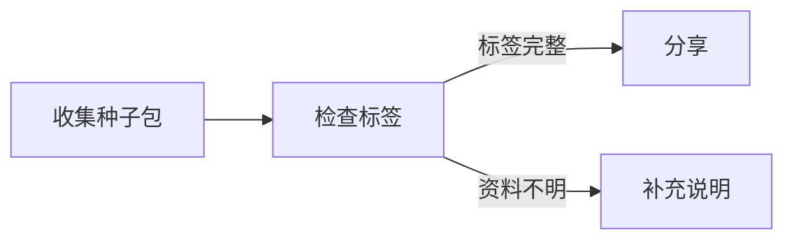

# 04｜数据结构与算法

## 1. 先看复杂度，再看代码

最常用的渐进符号：

- O：上界；
- Ω：下界；
- Θ：同阶。

分析时区分：

- time complexity；
- space complexity；
- worst / average / amortized。

## 2. 递归、回溯与动态规划

递归适合树形结构和分治，但要注意调用栈。

Backtracking：

```text
选择
→ 递归
→ 不可行则撤销
```

Dynamic Programming 的核心是：

> 把状态定义清楚，写出依赖较小状态的递推，复用重复子问题。优化问题通常还需最优子结构；计数、可达性等动态规划也不必表达成“取最优”。

两种写法：

- top-down memoization；
- bottom-up tabulation。

## 3. Array 与 Hash Table

Array：

- O(1) random access；
- 连续内存；
- 中间插入删除昂贵。

Hash table：

- 平均 O(1) lookup；
- 依赖 hash function、load factor 和 collision strategy；
- 最坏情况可能退化。

## 4. Linked List、Stack、Queue

Linked list 适合已知节点位置时的局部插删，但随机访问差、缓存局部性弱。

Stack：LIFO，用于递归、解析、单调栈等。

Queue：FIFO，用于 BFS、调度、生产者消费者等。

## 5. Tree

常见树：

- binary tree；
- BST；
- balanced BST；
- heap；
- trie。

Heap 提供快速取极值，适合 priority queue、top-k、调度。

## 6. Graph Algorithms

最基础：

- BFS；
- DFS；
- topological sort；
- connected components；
- union-find。

加权最短路径：

- Dijkstra：非负权；
- Bellman-Ford：可处理负权，并检测源点可达负环；若某目标可经负环反复降低路径代价，就不存在有限最短路；
- Floyd-Warshall：全点对，复杂度高。

MST：

- Kruskal；
- Prim。

### 6.1 从作者图示到可核对的节点关系

图算法的第一步是知道边表示什么。图示讲解工具可以同时输入SVG和明确的节点/边清单：节点为`id、label、explanation`，有向边为`from、to、label`。它检查节点ID能否对应SVG元素，并不从线的位置、颜色或箭头形状理解业务。

以种子交换为教学例：



清单中声明collect→check、check→share、check→clarify。SVG和清单必须分别验证：SVG ID唯一、节点非空且全部存在；边端点已声明、同一有向对不重复、标签/解释非空。若SVG线画错而JSON边仍合法，这些检查不会自动发现语义冲突；需作者核对图与解释。

### 6.2 DFS阅读顺序、拓扑顺序与实际路径不同

一种候选阅读规则是：按节点声明顺序找所有入度0的根；从每个根作DFS前序，邻接点按边声明顺序访问；最后从尚未访问的节点继续DFS。先标记已见再递归，避免有环时无限展开。样本得到collect、check、share、clarify，展示全部分支。

这不是一条实际执行路径：share与clarify可能是互斥分支，阅读时都讲到不表示一次业务同时发生。它也不是拓扑排序。考虑A→B、A→C、C→B，若A先访问B，DFS前序为A,B,C，却把必须在B前的C放到了后面。

若需要DAG的先修顺序，用明确的拓扑算法，例如Kahn：先收集所有入度0点，取出一点后减少其后继入度，新变成0的点入队；直到队列空。处理数量不足节点总数，说明仍有环，不能给所有节点伪造拓扑顺序。稳定的并列顺序是额外政策。

图的业务含义也不能由算法替你确定：多条出边只证明有多个目标，不证明条件互斥、概率、因果或实际调用。先修图、程序CFG、数据依赖图与讲解导航图都可用有向边，但它们的路径解释不同。

### 6.3 根可达、分支与回边见证

在上述阅读合同中，branches列出出度大于1的节点与全部目标。unreachable特指“从所有零入度根都未访问到”的节点，不是“从用户当前选中节点到不了”。孤立点入度为0，会作为根访问；纯环A→B→A没有根，二者被列入unreachable，但最后补访仍使它们进入完整order。

检测有向环可给DFS节点三种颜色：未访问、当前递归栈上、已完成。边指向栈上节点时，截取当前路径到该节点再闭合，得到可检查的环见证。给示例增加clarify→check后，可得`[check,clarify,check]`；自环得到`[x,x]`。

这些是DFS回边产生的见证，不是枚举全部简单环。每条见证相邻对都应存在于原图，首尾相同；换节点/边声明顺序可能得到另一组见证，不能把见证条数当成与遍历无关的“环总数”。需要强连通分量或完整环枚举时，明确改用相应算法和输出合同。

邻接表适合线性遍历，但若像来源一样对每个节点反复过滤全部边，建表/找根已经可能达到O(VE)。环见证还要输出路径，成本随输出规模增加；不能只记“DFS是O(V+E)”就忽略实现和输出。大图需节点/边/递归深度与资源边界。

### 6.4 人工阅读顺序与解释怎样保存

审阅可改order和已知节点的解释，边保持不变。order必须包含每个当前ID恰一次；reviewed严格为布尔；覆盖解释必须非空且属于已知ID。返回深复制，避免审阅结果改坏输入图。

完整排列只证明没有漏点、重复或未知点。`[clarify,share,check,collect]`也可能是合法阅读排列，不自动满足边邻接或先修顺序；reviewed=true只是自报审阅状态，不证明解释正确、学习者理解或有人具有批准权限。来源没有测验/答案评分系统。

同ID仍可能对应另一版图，所以长期审阅应绑定图与SVG内容版本、解释修订及审阅范围；不能让旧ID完全相同的旧审阅无条件套到新边/新说明。来源schemaVersion=1并没有实现这种内容绑定。

### 6.5 受限SVG输入与可导航输出

来源只接收受限的作者SVG：限定svg/g/基本形状/text/title/desc等标签，属性需引号包围；拒绝script、foreignObject、链接、事件、style与url()绘图来源，ID限制为小写字母开头的字母数字/短横线。500000的限制按JavaScript字符串长度，不是UTF-8字节预算。

这种正则加栈的解析只服务教学子集，不是完整XML验证器或任意SVG消毒器。还应明确文本/实体、重复属性、命名空间、节点数量与数值属性规则；保留原SVG前先确认支持范围。公开render接口直接接收SVG时，也不能绕过前面的载入校验。

输出HTML用节点按钮和Previous/Next导航，高亮当前SVG元素，显示分支目标并编辑说明；动态解释用textContent，嵌入JSON另转义脚本分隔。可键盘聚焦不等于完整无障碍验收，还需核焦点顺序、长说明、读屏语义和视觉状态。

graph-review.json下载后重新导入，才校验并保存修改；graph.json保存审阅后的图和顺序，analysis.json仍说明图结构，HTML供阅读。来源逐个写文件，未提供整体原子发布。作者截图中改了check的解释并勾选审阅，不证明下载后已重新导入，也不是程序运行路径。

### 6.6 自检与实际范围

1. 对A→B、A→C、C→B手算DFS前序和拓扑序。答案：按上述边顺序前序A,B,C；合法拓扑为A,C,B，二者不可混称。
2. 纯环A↔B为何仍进入order却在unreachable？答案：先从零入度根计算覆盖，再补访余点，这是两个阶段。
3. 一个完整逆序审阅为何可通过？答案：只检验排列，不检验拓扑；若业务要求先修，必须增加相应合同。
4. ID都在SVG中是否证明图语义正确？答案：否，几何、清单、说明与实际过程仍要核对。

四个交互实验分别演示ID集合差、固定分支/回边开关、完整排列和索引导航，不是通用图分析或真实审阅收据。25个测试（7/6/6/6）本次只静读，未执行来源TS/JS/CLI、浏览器脚本或评分器。原图、图结构与解释均为作者明确提供，没有自动图像理解。

来源：[第一来源Diagram Reading Companion](https://github.com/rohitg00/ai-engineering-from-scratch/tree/1a8c4fd5f5b3012e50e111f694b4d84df8a4eb1e/projects/diagram-reading-companion)，固定源提交2026-10-15，本库2026-10-23续接读取。共同2700字符（UTF-8为2701字节）辅助尾段与92已全读文件精确复用，其余新文本实际完整读取；逐项与媒体分类见[融合记录](../维护/来源更新/2026-10-16/102-图示阅读项目读取与融合.json)。

## 7. Sorting

需要理解而不是死背：

- insertion：简单、小规模或近乎有序时有价值；bubble 主要用于教学，通常不作为工程首选；
- merge sort：稳定，O(n log n)，需要额外空间；
- quicksort：平均 O(n log n)，最坏 O(n²)，通常不是稳定排序；随机化/选枢轴策略影响其表现；
- heap sort：O(n log n)，额外空间小；
- counting/radix：利用键的结构突破比较排序下界。

## 8. Binary Search

Binary search 不只是“找某个值”，更常用于：

> 在单调条件上找第一个/最后一个满足条件的位置。

因此它可以解“答案空间上的搜索”。

## 9. 选择数据结构的顺序

先问：

1. 最频繁操作是什么？
2. 是否需要顺序？
3. 是否需要随机访问？
4. 是否频繁插删？
5. 是否需要按优先级取元素？
6. 是否需要前缀/区间/关系查询？
7. 数据能否全部放内存？

## 10. 工程视角

Big O 相同不等于实际一样快。还要看：

- cache locality；
- allocation；
- branch prediction；
- constant factor；
- data distribution。

来源：Compendium Chapter 14 全部六节。

## 11. 可运行练习：第一个不小于目标值的位置

以下使用 Python 3，只依赖内置语法。前提：列表已按升序排列。

```python
def lower_bound(values, target):
    left, right = 0, len(values)
    while left < right:
        middle = left + (right - left) // 2
        if values[middle] < target:
            left = middle + 1
        else:
            right = middle
    return left

for values, target in [([1, 3, 3, 8], 3), ([], 5), ([1, 3], 9)]:
    print(lower_bound(values, target))
```

输出 `1`、`0`、`2`。返回长度表示不存在满足条件的元素，调用者不能直接拿该位置索引。循环不变量：`left` 左侧都小于目标，`right` 及其右侧都不小于目标（或 right 是尾后位置）；每轮缩短待查区间，故终止。随机访问数组上时间 O(log n)，额外空间 O(1)。

自测：输入未排序时会抛异常吗？答：通常不会，但输出不再有正确性保证；必须检查算法前置条件。用链表时中点访问昂贵，不能直接沿用数组的时间分析。
