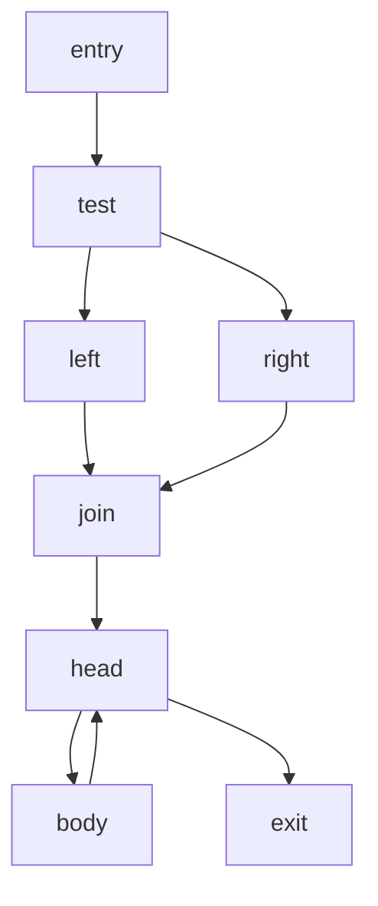

# 控制流与中间表示

先在[布局章节](01-二进制布局与装载地址.md)确认分析的字节，再用[指令与ABI](02-指令ABI与编译惯用法.md)解释局部效果。本章把它们组织成控制流图（CFG）与中间表示（IR），再说明SSA如何保存不同路径上的定义，最后才讨论可读伪代码。

整个过程逐步增加假设：容器范围正确不保证解码正确，解码正确不保证真实可达，CFG存在不保证指令语义齐全，IR像代码也不保证等价。每层保留未支持项和覆盖范围，才能定位后面的错误来自哪里。

## 1. 线性扫描和递归下降会在哪分歧

线性扫描按当前指令长度向后走，适合连续代码，但会把内嵌常量表、填充或不可达区也解成指令。递归下降从已知入口开始，跟直接分支、条件落空等候选边展开；它能跳过部分内嵌数据，却可能漏掉间接跳转、额外入口或未知调用行为。

自造一个不执行的10字节例：

```text
偏移  字节                解释
00    eb 04               从下一位置02加4，直接跳到06
02    31 c0 90 48         本例声明的内嵌数据
06    83 c0 01            add eax, 1
09    c3                  ret
```

若扫描器在JMP后仍从02顺序解码，可看到XOR、NOP，再把05的48当REX.W并吞入06～08，生成“从05开始的ADD RAX,1”。从入口00跟直接跳转则到06，得到ADD EAX,1。二者不仅边界不同，写入宽度也不同；EAX写入清RAX高32位，RAX加法不这样做。

这证明线性扫描可能误解释本例声明的数据，不证明所有“递归没走到的字节”都是数据。对未知程序，应标成未覆盖区，继续核符号、重定位、异常入口、调用目标和索引约束。多个工具可能共享同样的线性扫描或后端，输出一致也不构成独立真值。

静态候选可达也不等某次执行真实经过。条件可能不可满足；一个CALL可能不返回、抛异常或非局部跳转。无法恢复的间接目标应保留unknown边，不能补一个“看起来顺眼”的目标让图完整。

## 2. 从指令边界构造基本块

基本块在所采用的模型中有一个入口，内部按顺序执行，控制转移发生在末尾。一个实用划分过程是：先收集入口、有效分支目标、条件分支后的落空位置等leader，再沿已确认指令边界切块，最后按末条指令建立有类型的边。

| 边 | 表示什么 | 不应暗中假定什么 |
|---|---|---|
| fallthrough | 正常顺序到下一块 | 被识别为普通指令的操作一定不会终止/异常 |
| conditional-taken / not-taken | 条件分支两种结果 | 两条路径在所有输入都可行 |
| direct jump | 确定的跳转目标 | 地址落在文件内就一定是合法指令入口 |
| call | 调用另一个过程 | callee一定正常返回，或返回后所有寄存器不变 |
| return / tail transfer | 返回或交给另一函数继续返回链 | 所有JMP都是循环、所有无CALL都是内联 |
| indirect / exceptional / unknown | 模型需要但尚未完整解析的控制 | 删除这些边不影响支配与结构化结论 |

若分支目标落进已解码指令中间，不应直接把它接入原块；先记录边界冲突。跳表恢复还需要合法index、表基址、元素宽度、重定位或实际表字节和地址构造。值表只是返回数据，不能因为出现索引load就添加case控制流边。

函数范围也不是由“第一个RET”唯一决定。函数可能有多个返回、早退出、冷热分片或尾调用；按地址走到首RET就停止，会漏掉后面的合法块。某些工具在label处额外切块，两份CFG的块数/边数因此不同，应先统一到同一层次再比较，不能直接称边数少者漏了真实路径。

## 3. 支配：所有入口路径必须经过谁

对从入口可达的节点b，若每条入口到b的路径都经过d，就称d支配b。每个节点支配自身，入口支配所有可达节点。严格支配排除自身；直接支配者idom是最接近b的严格支配者，不是任意一个前驱。

考虑下图：



join的支配集合是`{entry,test,join}`，left不支配join，因为还能经right到达。head的支配集合再加head；body的集合再加body。因此`idom(join)=test`、`idom(head)=join`。先排除不可达节点，否则对没有入口路径的节点直接套“每条路径”会产生不适合程序分析的空真结论。

集合方程为：入口只取自身；其他可达节点取“自身并上所有可达前驱支配集合的交集”。将其他节点初始设为整个可达集，反复计算至稳定。下面是本库自写的完整教学实现，使用有限邻接表，不读文件或执行任何指令。

```python
def dominators(graph, entry):
    reachable, pending = set(), [entry]
    while pending:
        node = pending.pop()
        if node in reachable:
            continue
        reachable.add(node)
        pending.extend(graph.get(node, ()))
    pred = {node: set() for node in reachable}
    for node in reachable:
        for target in graph.get(node, ()):
            pred[target].add(node)
    dom = {node: ({entry} if node == entry else set(reachable))
           for node in reachable}
    changed = True
    while changed:
        changed = False
        for node in reachable - {entry}:
            parents = iter(pred[node])
            common = set(dom[next(parents)])
            for parent in parents:
                common.intersection_update(dom[parent])
            value = common | {node}
            if value != dom[node]:
                dom[node] = value
                changed = True
    return dom

g = {'entry': ['test'], 'test': ['left', 'right'],
     'left': ['join'], 'right': ['join'], 'join': ['head'],
     'head': ['body', 'exit'], 'body': ['head'], 'exit': []}
assert dominators(g, 'entry')['join'] == {'entry', 'test', 'join'}
```

可达的非入口节点至少有一个可达前驱，因此这里的next有效；不可达分量不会进入返回字典。教学代码便于看懂固定点，集合和重复遍历会增加大图成本；工程实现可用位集、反向后序（RPO）与直接支配树算法减少开销。RPO改善迭代顺序，不意味着任意有环图都只需一遍；不能把地址从小到大处理一遍称为一般数据流求解器。

## 4. 自然循环、后支配与结构化的边界

对一条边body→head，若head支配body，它是自然循环分析中的回边。可以从body沿前驱向后收集到head形成循环候选；地址更小的跳转本身不够，跳去共享错误出口也可能是向后分支。完全展开的循环可能没有回边；不可约的多入口循环也不能硬塞成一个自然循环。

后支配把问题反过来问“从某点到选定退出的路径必须经过谁”，常用于找if/else的汇合点。多出口可以建立虚拟出口，但异常终止、未知边和不终止路径需要明确模型；不能选遇到的第一个退出块就声称得到整个函数的唯一结构。

将图变成while/if/switch时，应说明哪些边和路径支持该结构。多出口、无限循环、不可约图或未恢复间接目标，可以保留label/goto或明确未知。相比伪造一个整齐但改变行为的循环，这样更方便继续核验。一个RET或JMP附近的地址排序不是结构化规则。

## 5. IR先保存机器效果，再追求可读

IR把不同指令变成便于分析的操作，例如带位宽的ADD、LOAD、STORE、比较、分支和调用。高层表达式只是后续简化。一个合格的提升过程至少说明寄存器视图、flags、内存、调用与异常如何表示。

- 写AX时，新的RAX应保留旧RAX高位；写EAX则零扩展到RAX。把AX/EAX/RAX全部当一个无宽度变量，会制造错误的定义与常量传播。
- 普通整数XOR清零还会更新条件码，不能只替换为`x=0`而遗忘随后JZ读取的ZF；PXOR等SIMD指令又有不同flags语义。
- CALL除结果载体外，还可能破坏caller-saved状态、flags及可变内存。未知callee不能默认零参数、32位结果且无其他影响。
- 栈push/pop和SP变化可能影响后续地址；基于文本相同的`[rsp+8]`命名，不足以建立同一个内存变量。

ESIL、RzIL、Ghidra P-code与VEX的操作、临时量和flags策略不同；有的显式展开flags，有的用延迟计算状态。比较时先统一架构、位宽、地址空间与版本，不能用IR条数判断语义更完整。某条指令的IR为空，应保留未建模项，不能靠助记符仍可打印就继续宣布仿真完成。

## 6. SSA解决同名变量在不同路径上的定义

静态单赋值形式要求每个版本只定义一次。例如left中`x1=3`，right中`x2=5`，到join不能直接任选一个覆盖另一个，而应写：

```text
left:   x1 = 3
right:  x2 = 5
join:   x3 = phi([x1, left], [x2, right])
        y1 = x3 + 1
```

phi根据进入join的前驱边选择值，不是同时相加，也不是运行时随便挑一个。多条phi在块入口体现并行选择；将它们降成串行赋值可能破坏交换变量的效果，需要临时量或正确的并行copy调度。LLVM的phi必须在块首，其incoming use按对应前驱边解释；其他IR仍要核自身合同。[LLVM phi定义](https://llvm.org/docs/LangRef.html#phi-instruction)。

循环head可能合并初始化值与上次迭代值：`i1=phi([i0,join],[i2,body])`，body中定义`i2=i1+1`。这正是不能按地址只扫描一次的原因。phi的每个操作数要对应实际前驱，不能只填“目前算得到的几个值”。

### 支配边界与重命名

节点d的支配边界包含这样的块b：d支配b的某个前驱，但不严格支配b。在图中的left/right分别定义x后，join是需要考虑合流的位置；循环body定义i后，head也可能成为phi位置。

通常先求支配树/边界，在定义点的迭代支配边界插入phi，再沿支配树深度优先重命名。每个变量维护版本栈，进入新定义就push，处理子树后pop；前驱向后继phi填写当前可见版本。结合活跃性可省去不需要的phi。把所有同名phi值直接union成一个变量，可能使同时活跃的不同值相互覆盖，不能当通用去SSA算法。

## 7. 寄存器SSA不能自动解决内存别名

如果`p`与`q`可能指向同一地址，`store(p,7)`可能影响后面的`load(q)`。把load表达式按文本缓存后直接复用旧值，会漏掉这次改变。相同栈偏移也可能因SP变化、不同路径或重叠宽度而代表不同字节范围。

可以用内存版本和读写摘要组织依赖，再结合alias分析减少不必要关联。LLVM MemorySSA中的MemoryDef/MemoryUse/MemoryPhi提供这种分析结构；它不是简单给每个指针字符串各建一条独立SSA链，也不等于已经精确知道所有写入影响。[LLVM MemorySSA](https://llvm.org/docs/MemorySSA.html)。

LOAD、除法、volatile访问、原子操作、调用和异常的可观察性还取决于所选语义模型。只把CALL列为副作用，再删掉未使用LOAD或IDIV，可能删除原有fault/trap；把本来不执行的操作提到分支之前，也可能引入异常。任何“优化保持行为”的说法都应先定义要保留的结果、内存、异常和环境作用。

## 8. 从SSA到伪代码，保留哪些不确定性

反编译是在约束下寻找可解释的高层表示，不是恢复唯一源码。同一个机器序列可能来自不同表达式；内联与优化会消除变量边界；寄存器宽度提供信息，但不足以唯一恢复int/unsigned/pointer/const等原型。

例如源码在满足定义域时可把先乘后除改成不同表达式，但固定位宽溢出、截零、异常和ABI会使“看似相同的数学公式”在程序中不同。打印成C还需核语法、类型、整数提升与别名规则；某工具特殊切片/undefined类型可能是IR记法，不能直接拷贝去编译后声称全自动重建。

控制流缺边会影响支配与phi，提升缺flags会影响条件，未知调用会影响传播，错误类型会影响伪C的除法和返回值。因此验收时保留各层中间结果：输入文件与范围、解码覆盖、typed edges、寄存器/flags/内存效果、SSA合流、结构化假设和未支持项。只比较最终文本是否像参考答案，会把这些失败压在同一个分数里。

### 应用关系图：把语法事实与运行路径分开

分析JavaScript应用时，还可建立模块、入口、IPC和资源关系图。这与机器CFG的节点含义不同：一个节点可能是文件、模块实例、桥接API、通信通道或端点；一条imports边不是一次实际函数调用。

手册的六文件示例可以直接从源码读出这条链：

```text
package.json 的 main
  → main.js 创建窗口并指定 preload.js
  → preload.js 暴露 ledger.percentChange / gradeLabel / log
  → 两个 invoke 和一个 send 使用三个字面量通道
  → main.js 的两个 handle 和一个 on 注册对应处理器
  → 处理器调用 ledger.js 中的计算或输出函数
```

index.html另引用renderer.js。后者在DOMContentLoaded处理函数中，先尝试fetch相对地址/api/ledger/latest，将JSON写入localStorage，再调用桥接API并更新页面。静态分析能确认这些语法和字面量，尚未证明页面成功加载、相对URL对应有效服务、请求成功、数据符合约定或处理器实际被调用。

| 图中的关系 | 可以静态核的依据 | 尚需保留的未知 |
|---|---|---|
| loads/imports | 文件引用、入口配置、模块绑定 | 动态路径、条件装载、打包器执行和模块副作用 |
| exposes/invokes/handles | 桥接成员、调用表达式、唯一字面量通道配对 | 动态通道、多个候选处理器、别名重赋值、实际注册与可达性 |
| calls endpoint | fetch表达式和URL字面量 | URL解析、网络是否发生、响应和错误路径 |
| persists_to | setItem及键字面量 | 是否执行、值来源、存储是否可用与成功 |

原捕获应用图有42节点59边、无截断；另一层语义图仍有118个unknown，12类语义关系均为partial。这并不矛盾：在已定义的抽取合同内把所有已发现应用节点返回，与完整理解数据流、调用流和运行时语义，是不同的覆盖目标。解析成功、未知计数0、未截断，也不能各自单独证明某类语义完备。

分页视图还要保留父记录与范围。modules集合15项不等15个源文件，本例只有6文件；summary的complete-within-view和exhausted只针对当前投影，不表示已经逐项读取或验证了完整父图。扩大范围时沿父记录继续调查，不能用一个摘要替换全部证据。

## 9. 中文练习与参考判断

| 练习 | 参考判断 |
|---|---|
| 自造10字节例从00与05分别解读 | 正确入口跟JMP到06是ADD EAX；从05的REX.W得到另一宽度，说明错误边界会改变语义 |
| 在示例图中删去right→join | 这是改变图语义，不是无害美化；可能改变join支配者与phi需求 |
| 给邻接表加一个不可达环 | dominators返回中不应把它算作入口可达；不能用空真获得伪支配关系 |
| 判断body→head是否自然回边 | 先核head支配body，不能只看head地址更小 |
| 将两条phi降成两条普通赋值 | 检查是否互相覆盖，必要时用临时量保并行语义 |
| 对AX写入后传播RAX常量 | 必须保旧高位；不能套EAX零扩展规则 |
| 删除一个未使用的除法结果 | 若原除法可trap，删除前须明确保持哪些可观察行为和输入前提 |

## 10. 把八个阶段接成一台小型反编译器

前面的原理可以接成一个可检查的工程：输入是自己编译的ELF64小端x86-64可重定位对象，输出是受限C表示与验证报告。先只支持六个System V INTEGER参数、整数指令、已识别的表和固定栈模式；浮点、栈上传参、复杂返回、未知间接调用等应显式拒绝或保留未知。能读ELF不表示后续每种指令都能提升。

### 10.1 用中间合同定位错误

不要让每层只传一个字符串。一个实用的数据流如下；方括号是对象身份和坐标，状态项沿各层传递。

```text
原对象[哈希、target、构建前提]
 → sections/symbols/relocations[节ID、节内偏移、完整span]
 → instructions[原字节、长度、操作数宽、字段位置、flow]
 → blocks/edges[入口、typed edges、冲突、未解目标]
 → IR[寄存器片段、flags、内存、调用和异常]
 → SSA[版本、定义宽度、phi前驱、入口值]
 → 简化IR与类型候选[每条改写的前提和证据]
 → 结构化C[仍保未知与依赖]
 → 两类验证记录[目标/候选/环境/覆盖，不覆盖项]
```

八阶段的最小交付与拒绝条件可以这样安排。原项目的模块名只用于方便对应，不要求照抄实现。

| 阶段 | 本阶段输出 | 继续下一阶段前至少检查 |
|---|---|---|
| 1．加载elf | 每张符号表、RELA与函数范围；对齐区另列 | 表大小整除、link/info、符号身份、完整补丁span；未知重定位宽度不能猜4 |
| 2．decoder | Instruction及位移/立即数字段位置 | 截断、15字节上限、实际支持的prefix/宽度、原字节与listing对应 |
| 3．cfg | 递归下降结果、表、块、支配与后支配 | 每条边落合法指令起点，冲突/越界/未解目标没有静默消失 |
| 4．ir/ssa | 带效果的IR和版本化定义 | flags与部分寄存器不丢，phi源覆盖前驱，定义支配用途 |
| 5．passes | 改写后的IR与每轮变更数 | 位宽、舍入、trap、内存和调用效果保持；达到轮数上限要报未收敛 |
| 6．types | 参数、返回、web和布局候选 | ABI前提、未知入口读、符号性冲突和不可见字段均记录 |
| 7．structure/emit | 条件、循环、switch及合法C表达式 | 循环头重算、所有出口/label、声明、类型与机器语义对应 |
| 8．verify | 行为与代码/依赖两腿 | 具体方法见[验证章节](06-差分重建与符号执行.md#小型反编译器验证)；读者亲自运行另记 |

前三层尽量共享同一份只读ParsedObject，以免各模块独自重解析时丢失节身份或采用不同范围。不可变表达式适合比较/替换；语句和块可以有独立ID，修改后重新计算相关分析，不能继续使用过期的uses、支配或类型结果。

### 10.2 从一条重定位连到两种switch

受控样本band在O1位于.text+0x50，大小0x17。LEA从0x5c开始，位移字段在0x5f，指令结束0x63；其PC32引用.rodata节符号，addend为−4。因此目标节内偏移为`0−4+(0x63−0x5f)=0`。解析器应同时保留“引用的是.rodata”和“偏移0”，不能把它误接到.text+0。

O1代码先准备默认值−1，`cmp $5`之后用无符号JA排除大于5的索引，再读取六个32位值`5,8,12,20,20,35`。这是数据查表，CFG只有三块，没有间接跳转。可读表示为“索引在0～5才读表，否则保默认”；负输入转换为uint32后也被排除。不能把原来的有符号参数全局改成unsigned，只为省去这处比较的转换。

O0则在0x76有`jmp *rax`。没有表恢复时只得到16条递归可达指令，六个case块未进入图；结合.rodata的六条PC32记录，目标为0x78、0x81、0x8a、0x93、0x9c、0xa5，得到28条递归解码指令、10块15边。包含对齐区的线性扫描有29条，额外的NOP不是新业务路径。汇合返回块0xb5是入口的直接后支配者；六个case块的直接支配者是承载间接跳转的0x64块。

这里的表长并非“看到附近cmp就取N+1”。应证明比较支配索引访问，比较和load使用同一索引值，期间没有重赋值或调用破坏，guard方向确实排除了非法范围，再检查整张表、每条重定位和每个目标。最近的其他变量比较、地址相邻却路径不相干的guard，都会误导简单模式匹配。表基址、entry位移、代码节偏移也必须在正确坐标系中相加；跨节ET_REL不能拿两个从零开始的偏移直接拼成链接地址。

### 10.3 具体完成一次循环SSA

O1的fold循环块0x80同时是自身回边的目标，支配边界包含自身。块内定义了rax、rdx、rsi和flags，所以初始插四条phi；rcx只在循环前的0x74定义，不因此插phi。每条phi分清来自0x74的初始化值和来自0x80的上一轮值：

```text
循环前：edx_1 = 0，esi_1 = 0，eax_1 = esi_1
循环头：rdx_2 = phi(0x74: edx_1, 0x80: rdx_3)
        esi_2 = phi(0x74: esi_1, 0x80: esi_3)
        eax_2 = phi(0x74: eax_1, 0x80: eax_5)
        flags_2 = phi(0x74: flags_1, 0x80: flags_6)
```

rdx的两路定义分别为32和64位，合流需64位，并把32位写入的清高位效果带过去。循环末比较读取rcx的64位视图，而此前定义ecx为32位，因此应读`zext64(ecx_1)`。不能因为“同一寄存器家族”就把所有用途统一成32或64位。

实现重命名时，先为入口版本0建立状态，再沿支配树进入块：给phi目的创建版本；按顺序用当前栈顶替换普通用途，再为目的push新版本；在通向后继的每条边上填写phi源；递归子树后撤回本块push的版本。若回边直接到函数入口，phi还需一个代表首次调用的虚拟前驱，不能让第一轮读取上一轮才定义的值。

随后可传播副本、消去未用flags，并将确实同值的phi合并；本样本最终剩两条循环phi。这是本样本的数据依赖结果，不是“循环永远只有两个phi”。验证SSA除了无重复定义，还要检查用途的支配、phi源和前驱一一对应、位宽及未初始化入口值。

消除SSA时也不能无条件把phi及所有源union为同一C变量。若一个合流需要并行执行`a←b，b←a`，串行写会丢旧a；可用临时量`tmp←a，a←b，b←tmp`。一般实现需活跃区间、干涉检查及边上的并行copy调度，必要时拆临界边。

### 10.4 简化必须保住时序与机器效果

record先读取reads，再加1并写回。假设调用前reads=0、total=10、value=5，正确执行应得到reads=1、total=15、返回15。以下顺序中的t保存了旧内存计算出的值：

```text
t = load32(p + 0) + 1
store32(p + 0, t)
u = load32(p + 4) + value
store32(p + 4, u)
return u / t
```

若把t的表达式移到最后、仍写成`u / (load32(p)+1)`，load读到已写回的1，分母变2，得到7。SSA保护的是寄存器定义，不会自动保护内存；这正是load跨store/call不能随意内联的原因。即使没有store，还需考虑volatile、可能fault、别名、路径和调用摘要。

常量传播先对具体操作分支，再计算该操作；不能构造一个包含所有候选运算结果的字典，让并未使用的`a << b`也被提前求值。负移位或异常大的计数可能令本来不涉及移位的常量加法也失败。固定宽度运算还需按ISA处理shift计数和截断，而非直接套Python无界整数。

乘移除法识别可复用[常数除法原理](02-指令ABI与编译惯用法.md#常数除法推导)：本例0x66666667配移位34/33分别解释除10/5，0x55555556配32解释除3。识别时还要检查输入是符号扩展的int32、乘积是所需64位、两路来自同一乘积、截断和负数补偿完全吻合。几个边界样本是纠错工具，不能代替这些前提和误差界推导。

flags也需逐操作建模。XOR清零仍写ZF等，INC保留CF，IMUL部分flags有效、另一些未定义，移位的flags依计数而异。把整个flags当普通变量有利于分析，但必须表达保留/失效；不能让后续分支继续读取一个过时的比较。将ADD后的有符号条件统一替成“回绕结果与0比较”，还可能漏OF的作用。

### 10.5 结构化时保留每次循环头与每个出口

后支配者帮助定位if汇合，循环header/latch帮助区分while和do-while，但形状匹配还必须保存语句执行次数。若循环头每次执行`v=load(p)`，循环体又会改写p，不能只在while之前算一次v。一个保守的表示是：

```text
while (true):
    执行循环头中的计算
    if 退出条件成立: break
    执行循环体并回到循环头
```

只有证明循环头计算可安全外提，才能改成普通的循环外赋值。多出口需保各自转移，多latch需保对应回边，不按地址排序任选首个；无正常出口的SCC也不能假装有后支配返回块。

共享区域若需要goto，要同时输出相应label，并保声明和边上copy。未解析间接跳转不能因structurer只认识带table的分支而从C中消失。无法保语义时，输出带原图与缺项的中间结果，或拒绝生成可编译候选，比输出一个省掉控制转移的函数更便于继续分析。

最后检查C自身的语义：目标32位加法的环绕不能自动由有符号int加法表达，负数左移、除法异常、严格别名、对齐和指针转换都需处理。生成器的优先级表能保括号，却不能解决这些问题；结构体和表要有完整声明，跨函数调用要有一致原型。可编译只是进入验证阶段的一个条件。

### 10.6 不运行工具也能先完成的检查

先手核band的两种表、PC32目标、一个phi的两路版本，再检查record的load/store顺序和循环头执行次数。能够输出每层的输入、结果、未支持项及一条反例后，再对自己实现的受控对象做实际运行。原项目的105个测试只覆盖其声明样本；本库已静读它们，没有替读者运行原评分器或取得项目证书。

八个原交互实验的有效用途是调参数帮助理解公式。解码图仅示意字段，并非完整decoder；结构化图直接套选择项模板，固定goto=0不证明算法；验证图用近似公式估网格，不是真实测试结果。判断实现仍应回到原字节、数据流和具体测试合同。

来源为第一来源固定`1a8c4fd`的第33、34、37、39课，教材源提交2026-10-15；本库2026-10-19复用逐项读取证据并按主题融合。原解码器、lifter和工具捕获没有在本轮执行；本文10字节例与支配函数为本库自写教学内容。LLVM官方只定点核phi和MemorySSA相关段，不把某版LLVM所有优化规则等同本章的机器语义。14主课图已另静读并回融；上述应用关系图案例于2026-10-19追加，逆向手册与两个项目知识已回融，14主课/十主题局部范围见专题入口，整轮更新仍待其它项目和全局验收。


手册补充来源为[第一来源逆向手册](https://github.com/rohitg00/ai-engineering-from-scratch/tree/1a8c4fd5f5b3012e50e111f694b4d84df8a4eb1e/manuals/reverse-engineering-101)，源提交2026-10-15，作者capture为2026-10-14；本库2026-10-19读取与回融。32节正文全读，配套采用明确的全文/同SHA复用、字段投影分类、SVG语义及窄二进制静核，逐项范围见[手册融合验收](../../维护/来源更新/2026-10-16/77-逆向手册主题融合验收.json)。本库未运行来源程序、REA、MCP、编译器、目标或模型；来源版本号、工具计数与耗时仅作具体案例。逆向项目已完成知识融合；整轮源更新仍待其它项目、配套和全局验收。


小型反编译器补充来源为[第一来源Mini Decompiler](https://github.com/rohitg00/ai-engineering-from-scratch/tree/1a8c4fd5f5b3012e50e111f694b4d84df8a4eb1e/projects/mini-decompiler)，源提交2026-10-15，本库2026-10-19增量融合。70原项采用45项实际全文、3同SHA全文复用、10项逐行映射复用/新增行读取、6唯一对象与2同字节副本静核、4演示媒体分类；8交互实验源码全读。4份listing的272条记录、899字节均核到对象.text；105个测试方法仅静读。这里的新解释是方法与边界的整合，不是原评分器/编译器/目标/JS执行证明。逐项范围和知识映射见[小型反编译器融合验收](../../维护/来源更新/2026-10-16/87-小型反编译器八阶段融合验收.json)。


## 固定控制流练习：条数、块、回边与表项各有分母

以下数据来自同一O1对象的存储反汇编，列出的指令字节已逐项与.text核对；这是被动检查，不是本次调用反汇编器或执行程序。

| 题目与条件 | 参考结果与判断 |
|---|---|
| 1. grade从0x10开始、在0x3d的ret结束；存储列表的指令起点为10、13、1a、1d、21、25、27、2a、2c、2f、31、33、3a、3d（均十六进制），递归可达多少条？ | 14条。条件跳转0x2f的目标0x3d及其顺序分支均可达；0x3e的对齐NOP不属于该符号范围。 |
| 2. total入口0x40分到0x44或0x5c，0x44进0x50，0x50回自身或到0x5b，两返回块无后继，有几个基本块？ | 5个：0x40、0x44、0x50、0x5b、0x5c。不是5条路径或5次循环。 |
| 3. 该循环头地址是什么？ | 0x50；回边源也在0x50块，目标支配源。不要拿函数入口0x40代替循环头。 |
| 4. 线性扫描在0x13把`48 83 c0 01`解成四字节指令，覆盖跳转目标0x14，该覆盖指令从哪里开始？ | 0x13。真实跳转到0x14时，应从那里重新解码`83 c0 01`；不能因为0x14在旧指令内部就删除合法目标，也不能同时把两种边界都当同一路径。 |
| 5. O0的grade按商6～10选择跳表，共几项？ | 5项，包含两个可能去同一处理块的case；表项数不等于唯一目标数。范围约束和表位置共同确定长度，不从后续偶然像地址的数据继续扩表。 |

### 用同一循环核对SSA与类型

设入口给出指针p和长度n：n≤0直接返回0；否则i=0、sum=0，循环执行sum+=p[i]、i++，直至i=n。前驱为0x44和回边0x50，活跃合并的是i与sum，所以循环头各需一个Phi，共2个；只在前置块赋值且不再变化的n不需要Phi。

| 题目 | 参考答案与边界 |
|---|---|
| 1. percent_change在SysV x86-64调用约定下实际需要几个参数？ | 2个，对应进入运算的EDI/ESI。ABI允许更多参数寄存器不等于函数使用更多参数；后来写EDX不自动证明第三参数。 |
| 2. 上述total循环在SSA中有几个Phi？ | 2个，分别合并索引和累加器。自写抽象CFG/支配边界核对与源码内置静态预期一致；没有运行原lift。 |
| 3. 有符号除法惯用式常数0x66666667、右移34对应哪个候选除数？ | 10；该常数是ceil(2^34/10)。还要核输入位宽、符号扩展和符号修正，不能只靠浮点比值宣布任意机器码等于除10。 |
| 4. percent_change参考打印的最后返回语句是什么？ | `return (param_2 - param_1) * 100 / param_1;`，来自源码内置静态预期；它前面还有param_1=0的返回分支。显示成这行C并不自动保留机器有符号溢出语义，需用明确i32模型核对。 |
| 5. total第一个参数被推成什么C类型？ | `int *`：32位访存、4字节步长提供证据。它不是原始声明的证明，也不单凭只读行为添加const。 |

源grader对打印语句作字面比较；一个代数等价表达式也可能被判FAIL。学习验收应同时看位宽/路径/内存行为，不把匹配某个打印器当通用反编译正确性。


这组新增练习依据[第一来源逆向课固定快照](https://github.com/rohitg00/ai-engineering-from-scratch/tree/3f9715c62a3bedcffb68a260f1a65ee2dd9cc10a/phases/13-tools-and-protocols)，源截止2026-10-23T13:09:18Z，本次2026-10-25核对。字节/存储字段、源码静态预期和自写数学模型层次分别记录；原grader/测试/目标均未运行，新增动画导览不当运行证明。完整范围见[新增实验融合记录](../../维护/来源更新/2026-10-24/02-逆向新增实验融合.json)。
