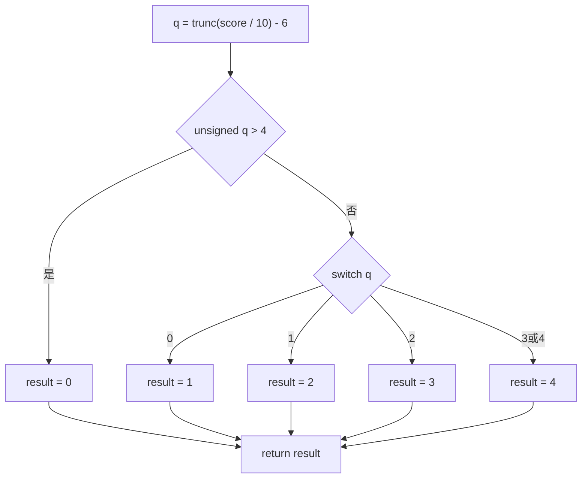

# 差分重建、等价边界与符号执行

读懂伪代码后，还要回答“它在什么范围内与目标等价”。先读[证据记录](05-静态与动态证据.md)，把目标、候选、工具与环境固定，再决定比较返回值、异常、内存、外部效果还是完整机器状态。本章结合有限网格、代码/依赖比较、函数匹配与符号路径案例，明确各种“相同”的适用范围。

## 1. 先声明你要证明哪一种相同

| 层次 | 可以检验的内容 | 仍需保留的限制 |
|---|---|---|
| 有限行为比较 | 某些输入上输出/异常/内存等观察是否一致 | 未测输入、未观察副作用和环境 |
| 代码字节比较 | 选定函数投影中的机器码是否相同 | 重定位、常量、调用目标、装载及其它依赖 |
| 依赖闭包比较 | 代码及实际引用数据/符号是否等价 | 外部库、运行状态、并发和动态变化 |
| 形式化/符号推理 | 在模型与约束下是否存在反例或性质成立 | 指令/库模型、路径覆盖、资源上限与外部行为 |

不同源码可能编译成相同机器码；机器码不同也可能在指定语义下等价。因此重建的目标通常是可解释、可检验的等价实现，不是恢复唯一原源码。先定义边界，才知道“相同”到底包含什么。

## 2. 一个先乘后除的反例

设目标计算`((after-before)*100)/before`，before为0时另有守卫。before=100、after=105时，先乘后除得到5；候选若改成`((after-before)/before)*100`，整数除法先截零，就得到0。十个恰好整除的“普通样本”可能全部通过，却漏掉这个错误。

再考虑把乘法改成较宽类型。它可能避免原固定位宽机器码的环绕，也改变溢出附近的结果。源C有符号溢出通常是未定义行为；讨论某份固定机器码的模运算，不等于给源C补上通用环绕语义。跨LP64/LLP64还不能靠`long`这个名字保证中间值同样宽。

除法异常也与目标有关。x86 IDIV在商溢出等情况下产生异常；AArch64 SDIV对某些相应输入给出其定义的结果。宿主harness如何把异常转成信号/返回类别，还受系统与实现影响。不能拿arm64上重新编译源码的一次结果替代原x86对象的执行，更不能把所有未知架构都按某一平台处理。

## 3. 网格按失败机制设计

| 机制 | 候选输入或观察 |
|---|---|
| 守卫与空输入 | before=0、长度0、空数组，核是否进入除法/访问 |
| 舍入 | 105相对100、负数且不能整除，核向零与floor区别 |
| 边界分段 | grade的59/60、69/70、99/100、109/110；负数和最大值 |
| 位宽 | 乘加/减法接近边界，区分源定义域与固定机器效果 |
| 异常 | 除0、商溢出、非法访问、超时分别记录，不揉成一个“error” |
| 内存 | 输入是否被修改、输出区大小、别名/重叠与越界 |
| 环境 | 不同架构/ABI/库/编译选项另立证据，不把结果混在同一网格 |

原grade按`score/10`的case选择，110可能回到default；改成“只要≥90都返回最高档”会在110等输入出错。C负整数除法向零截断也不能直接拿Python的`//`作reference。

先写独立预期或可信reference，再执行候选；两边共用同一个错误模型，容易共同通过。记录实际执行案例数、应执行数、未执行、超时与失败原因。0个case、缺一函数、只有空evidence ID列表，都不得因mismatch=0而获得通过。

## 4. 行为harness本身也需要验收

每个输出必须匹配函数、输入和案例ID；不能只将输出行与输入zip，忽略多余行、错序或回显不符。核完整退出状态与输出格式，保留超时/崩溃；只取最后两个token会给注入或错行留下空间。

执行时限、进程/资源边界与错误分类属于harness合同。捕获SIGFPE不代表也处理SIGSEGV、死循环或Windows异常；宿主重编译版本不能冒充原对象。同一个candidate在两个编译单元间的声明/定义类型若不兼容，ABI偶然能传值也不是C标准层面的全域等价。

第34课lifter测试的O0行为比较用stub替代grade并过滤其结果行，因此不能由最终报告推出该O0 switch行为也已执行验证。本库保留这种缺项，不能把总体行数或退出0掩盖了的未测范围再抹掉。

## 5. 为什么代码相同，常量错一个也会失败

一份grade候选可与目标有相同46字节代码，但值表最后一项从4变为3，case10就改变了。比较函数机器码不包含被引用常量时，会漏掉这个差异；字符串表、相对地址表、外部调用目标同样可能在函数字节之外。

对重定位位置做mask，只是从比较中暂时排除尚未定址的字段，不是删除其语义。还须比较：

1. 补丁位置、类型、宽度和目标section/符号是否对应，范围是否合法。
2. addend如何影响最终目标，是否指向相同语义的数据或代码；不能一律忽略。
3. 引用数据的长度、内容与依赖是否完整；短读双方都只得到同样前缀，仍不能验收。
4. 外部符号解析、PLT/GOT、库版本和运行环境是否落在声明范围。

未知重定位不能默认mask四字节；负数、越界和不受支持的重叠记录应拒绝或保未知。ELF每张RELA表按自己的link/info找符号表/目标节，不应强用第一张符号表；SHT_NOBITS又不能当普通文件数据切片。

即使归一化后的listing文字一样，也不能说整个对象一样。比较器若只遍历第一个文件的函数，会漏掉第二个文件新添函数；若只比较助记符，还可能漏机器字节、常量、重定位和环境。明确叫“这份函数指令文本投影一致”，比给它取名identical后扩大含义更可靠。

## 6. 组合两条验证腿时，先检查必需项集合

行为比较和静态字节/依赖比较可以互相补充，但不能只把报告中“出现的项”做AND。先固定需要证明的claim集合，例如percent_change行为、grade行为、对应代码与值表依赖；每项都必须有匹配目标/候选/环境的合格证据。

| 情况 | 正确的组合判断 |
|---|---|
| 需要两函数，只有一函数测试 | 未完成，不能按已有项全PASS放行 |
| 行为报告0案例、0 mismatch | 无有效行为证据 |
| 静态腿为空列表 | 该腿缺失，不能利用all([])的空真通过 |
| 链接了另一候选/旧compiler的收据 | 身份或前提不匹配，重新核验 |
| 有运行错误但结果字段恰好相同 | 先按运行状态合同分类，不能直接成功 |
| 两腿有效且全部必需项通过 | 只在已声明的范围内通过，仍列环境/依赖限制 |

原课proof组装存在空leg、0cell、弱身份绑定等缺口；authority直接填observed也未补齐真实运行链。这里吸收两类证据互证的方法，并修正准入条件，不把自定义proof JSON当官方工具已经验收的凭证。

## 7. 函数匹配：唯一候选也可能配错

比较两个构建时，先固定函数范围、是否包含padding、比较对象文件还是装载视图，并核listing原字节来自对应文件。再计算不同投影：完整代码、重定位归一代码、助记符序列、CFG结构、符号名和引用数据。每个投影丢掉的信息不同，不能因为某一个相同就认定行为相同。

| 属性 | 适合提出的候选 | 主要盲区 |
|---|---|---|
| 原代码字节 | 编译和布局相近的函数 | 装载重定位可改操作数；依赖数据不在函数内 |
| mask后的字节 | 排除明确的待定地址字段 | mask太宽会丢真正变化；目标/常量仍要核 |
| 助记符顺序 | 忽略部分操作数变化 | 常量、寄存器和地址差异可能被抹掉 |
| CFG形状 | 优化或地址变化后的结构候选 | 相同度序列不等同构图，更不等行为 |
| 真实符号名 | 有可信名字的构建 | 自动名字、改名、别名、同名局部或不相干程序 |
| 字符串/表引用与调用邻域 | 补充结构和数据关系 | 引用恢复不全或外部依赖不受控 |

BinDiff式策略按某属性把两边未匹配函数分组，在当前比较子集中双侧都唯一时建立关联；歧义组可进一步细分，再借调用邻域扩展。这是一种关联策略，不是等价定理。助记符序列哈希、按素数乘积得到的指令多重集、CFG度序列和完整MD index都不是同一个算法。[BinDiff匹配策略](https://github.com/google/bindiff/blob/main/docs/concepts.md#general-matching-strategy)。

原课的贪心顺序先结构后名字，曾把O0的percent_change配给O1的grade_label：二者都呈四块菱形，度序列为`0/2,1/1,1/1,2/0`，并且该形状在两边恰好唯一。错误关联消耗了右侧候选，还影响后面的匹配。将可信名字提前能避免这个受控例的误配，但真实分析仍要核名字出处；“名字不同”可能是改名，不能一律当结构关联必错。

质量和相似度应附算法、范围与版本解释。某工具的good/medium或confidence10不自动是正确率，也不能直接与另一工具的1.0比较。强标签不弥补错误目标、截断函数或未知重定位。

## 8. 相同对象代码，为什么装载后字节不同

本课O1与O2的grade都有46字节相同对象代码，位移字段在`.text+0x36`，LEA下一指令在`.text+0x3a`。按作者Ghidra导入布局模拟：两份`.text`均在0x100000，`.rodata`分别在0x1000a0和0x100110，因为total变长而后移0x70。grade读取的值表在rodata+0x14。

| 视图 | O1 | O2 |
|---|---|---|
| 对象位移字段 | 零占位 | 零占位 |
| 装载视图的位移 | 0x1000a0+0x14−0x10003a=122 | 0x100110+0x14−0x10003a=234 |
| 四字节字段内容 | `7a 00 00 00` | `ea 00 00 00` |

字段宽4字节，但实际只有第一个字节不同；不能说“四个字节全改变”。明确归一这个重定位字段后，两份代码又相同。原始/归一视图的区别应同时保留：变化来自地址关系，不是可以永久删除地址语义。

这只是固定对象的导入布局模拟。真正加载ET_EXEC/ET_DYN、BSS、绝对/未定义符号和动态链接还要按各自规则处理。原教学loader会跳过NOBITS、绝对符号和部分未解析引用，不构成通用装载器。不能把一次从exact降为masked的匹配唯一归因为“数据移动”，还需逐字段确认实际重定位、目标和addend。

反过来，grade_case10_wrong对象与O1的46字节代码相同，引用表却为`1,2,3,4,3`，原表为`1,2,3,4,4`。这次是代码之外的真实语义差异。本库用自编ELF/RELA数据核对了两种情况，不执行原loader、编译器或对象指令。

## 9. 相似度的分母里究竟有什么

一种字节相似度为`1−Levenshtein距离/max(长度A,长度B)`。Levenshtein允许插入、删除、替换，不等于逐位置Hamming距离。结果必须附输入字节范围；空数据双方相同或被截断，不能因此通过函数验收。

本课O0 grade的完整符号范围118字节，与O1的46字节比较，比例约0.296610。未解析跳表时，原工具仅把四个静态已达块的82字节拼成fingerprint，距离47，得到`1−47/82=0.426829`。它显示的函数size仍可能是118，因此size列不足以说明参与比较的字节。

应用重定位后的视图又产生不同结果，原radiff2捕获为0.288136；只比较opcode也会得到另一组比例。整文件距离还混入头、符号和重定位表。要比较不同工具，先对齐对象、布局变换、函数/块集合、字节顺序、归一规则和分母，不用多个百分比投票证明函数相同。

本库独立重算过完整字节比例、82字节范围与47编辑距离，以及上述位移和外部表差异。原radiff2脚本丢弃stderr并筛sym行，现有四行结果不是完整诊断日志。Ghidra捕获中grade在O1/O2间除名字外，还被Instructions/Mnemonics correlator关联；原题目写“只靠名字”与记录矛盾，不能照用。

### 比较工具文本时，先看维度的定义

手册中的函数比较把identity、pseudocode、assembly、comments、calls、references、strings_names和cfg分开给unchanged/changed/unknown。每维所需facet不可用，或有界文本diff超时、超过编辑预算，都应保留unknown。这个汇总规则与“已知反例优先”的重建验收不属于同一层，不能不看合同就混成一个通用状态排序。

原捕获中percent_change八维unchanged，total有五维changed：伪代码300→2904字符、汇编336→1866字符、引用4→13、字符串/名字2→11、CFG块5→16。两个构建来自同一份源码，优化后的向量与尾部路径会改变表示；这些数字说明需要检查哪里，尚未证明行为变了。

其中assembly只是分析器打印的文本，并未解码和归一化重定位。仅地址或自动名字变化也能使它changed；文本中同一个表地址背后的值变了，却可能仍unchanged。calls维度的计数也要按其对象形状解释：本例计数1不等目标有一个callee，原dossier的callees实际为空。引用端点集合还可能丢失call/data等kind，核行为时不能省去关系类型。

指定“两个版本的汇编文本相同”的claim通过，只证明这个局部约定；若任务要证明返回值、内存、异常或外部效果，则必须另列相应claim与证据。原4个结构claim中2通过2失败，没有任何动态行为claim，不能把总体验证器名字里的verification当作全局等价证明。

## 10. 符号执行用一个状态表示一组输入

具体测试选一个输入并执行；符号执行令输入成为变量，维护环境/内存表达式与路径条件。遇到分支P时，分别考虑当前条件C∧P与C∧¬P：可满足则保留，不可满足则剪枝，未知则保留未知，不能当不可满足删除。赋值替换表达式，返回时得到“路径条件、返回表达式、状态与覆盖”。

下面是grade的简化模型；q按32位向零除法算`score/10−6`，入口无符号比较将负q等排到default。图表示输入条件，不表示本库执行了目标程序。

IR的每条语义需要能追溯到原指令及其前提。原课用手工简化IR，将乘移除10变成除法并列出对应指令地址；地址集合覆盖一次只核了来源范围，没有自动证明简化语义、flags、异常、内存和调用模型都正确。这里可结合[常数除法推导](02-指令ABI与编译惯用法.md#常数除法推导)理解这个特定等式，不能推广到任意手工lift。

## 11. 从一个样本推进到返回值集合

在有符号32位score上，向零除10的商在−214748364到214748364之间，减6不溢出。将q视为无符号后，q≤4恰好要求其有符号值在0–4，也就是商6–10。对这些正商，输入区间可直接推出：

| 返回值 | score集合 | 在−200..1200中的数量 |
|---|---|---|
| 1 | 60..69 | 10 |
| 2 | 70..79 | 10 |
| 3 | 80..89 | 10 |
| 4 | 90..109 | 20 |
| 0 | INT_MIN..59或110..INT_MAX | 当前有限域内1351 |

“90是一个解”和“所有解恰为90..109”需要不同证据。return0的min是INT_MIN、max是INT_MAX，但中间有一整段非零返回；只报告极值不能证明集合连续。输入计数、区间与样本要区别，必要时输出区间并集或可检查的公式。

O0简化模型按不同case目标得到5条路径，O1查表模型只有“查表/default”两条路径，却有同样的5种返回结果；路径数不等于返回类别数，也不等价于测试覆盖率。本库另用自写整数定义枚举−200..1200共1401个输入，核上表的有限域计数；全32位区间结论来自明确的算术推导，不冒称这1401格穷举了2^32个输入。

## 12. SAT、UNSAT与机器语义

SAT给出满足已编码条件的一个模型，模型可以不唯一。原捕获为percent_change返回50找到多组before/after：小范围可取−10/−15，angr和Z3则给出更大的值。核这些大值时应使用已声明的32位回绕及向零除法，而非Python无界整数或`//`；同一个数学表达式跨不同语义可能不成立。[Z3位向量的有/无符号操作](https://microsoft.github.io/z3guide/docs/theories/Bitvectors/)。

before=3、after=−1时，中间值−400，向零除3得−133，没有有符号溢出。after=1073741823或2147483647也可在特定32位回绕模型下得到−400，再得−133，但源码乘法已超出int32有符号范围。不能把二者都称为“C语言定义的同一种结果”。商溢出如x86 INT_MIN/−1还会触发IDIV异常，SMT位向量的总函数返回值不能自动替代它。

原Z3捕获将grade的乘移、移位和表手写成公式，再与另一份source-switch公式询问差异，得到UNSAT；与无上界threshold公式比较则SAT，样本score706346536就是一个反例。在0..109范围内，两种公式没有差异；110已经给出更容易读懂的反例。

| 求解结果 | 可以得出的结论 |
|---|---|
| SAT并有模型 | 当前公式存在满足赋值；按目标语义复核模型 |
| UNSAT | 当前完整编码的约束不可同时满足 |
| unknown/timeout | 尚未判定，不能当UNSAT |
| 有限域枚举无解 | 仅当前域中无解 |
| 未执行某路径/操作被跳过 | 模型覆盖缺失，不能据残余公式证明整体 |

证明两个目标在某范围等价，通常构造“合法输入前提∧可观察结果不同”的反例公式；若UNSAT，还须核双方模型忠实、必要路径完整、依赖/异常/内存/外部效果落在范围内。原手写Z3公式有硬编码表；不先证明它与目标当前数据一致，UNSAT只是两个手写公式的一致性。原angr脚本主要记录deadended而未完整审查errored等状态，也不能把没有返回状态时的空循环当“全路径无反例”。

本轮没有运行angr/Z3、原IR执行器或其测试。作者结果保留为原模型观察；本库独立重算了捕获中的整数模型和明确的字节/表关系，不将其升级成一次新的solver证明。

## 13. 循环上限截断的是状态，还可能包含很多输入

total输入count限在0..N时，本课简化模型每种迭代次数对应一条路径，N=2/4/8得到3/5/9条，具体数据values=1,2,…时返回三角和。一般多分支循环还可能指数增长；固定位宽输入域虽有限，也可能大到无法实际展开，不能一概说所有无显式界循环在数学上都有无限路径。

路径合并、不可行路径剪枝、函数/循环摘要、concolic测试与有条件的近似都可控制成本，但应写清是否牺牲覆盖。concolic先沿一次具体运行收集约束，再否定某个分支条件寻找新输入；它仍需处理外部环境与未支持操作。

本课手工IR设置每路径最多24个block。按其明确块深度，count0走2个block，正count完成需要count+3个，因此0..21共22个输入能完成。其余43个输入由两个截断状态表示：一个条件对应22，另一个对应23..64。原文“另外41个从未开始”不准确，因为后一个符号状态已经包含这些输入。

交付时分别报告完成状态数、截断状态数及各自覆盖的输入集合；状态数与输入数不能相减。只有把所有合法输入划分进完成、异常、截断或未知等集合，才知道结果缺在哪里。O2在count8也可能进入向量路径，和其他优化等级都产生9个最终count结果，不说明它们经过相同机器路径。

## 14. 工具分工与复查顺序

KLEE主要分析LLVM bitcode，angr主要从二进制装载与提升建立状态，Z3是解约束的求解器。它们的输入、运行时模型和责任边界不同。一次solver SAT不是目标实际运行，一次angr探索也不等全部系统环境被完整模拟。

angr中的Project/loader负责程序映像，状态包含寄存器/内存/约束，SimulationManager组织active、deadended、found、avoided等集合，错误还需看errored列表。explore找到指定目标后可以在其他路径仍active时返回，故found一个状态不表示枚举完毕；unconstrained等是否保存还取决于选项。[angr状态管理](https://docs.angr.io/en/latest/core-concepts/pathgroups.html)。

工具行为报告至少写明：输入文件摘要、载入基址/重定位、函数入口/ABI、参数位宽、实际初始化内存、库与hook模型、每类状态数量、求解时限/截断、公式/约束和反例复核。把源码在宿主重编译、执行原对象、仿真目标、重放工具文本分别记录。

实际复查按顺序进行：先核原字节和范围，再解释对象/装载投影变化，检查候选匹配及冲突，比较引用数据与环境，最后在明确语义与输入域中做行为测试或符号反例查询。来源中的商业工具版本、许可与研究覆盖率按历史背景或可选进一步阅读处理；没有捕获的工具不标为运行过，也不把安装练习当已经完成。

## 15. 中文自检与交付物

完成一次重建实验，应该能交出目标/候选与构建身份、观察合同、独立案例及结果、静态代码/重定位/数据依赖比较、所有缺项和反例、组合判断与适用范围。无需把巨量终端日志放进学习正文，收据应能定位原始记录并解释结论。

自检：为什么105相对100能区分两候选？为何110能反驳无上界threshold？为什么同代码还需看值表？为什么空测试/空静态腿不该通过？为什么另一个架构的运行不能冒充原对象？能给出具体反例和所需证据，才算理解，而不只是记住“两条腿证明等价”。

## 16. 小型反编译器的验证：从一组具体对象出发

### 16.1 先把原对象、候选和引用范围对上

另一个受控例band的O1函数是23字节，查表为`5,8,12,20,20,35`。故意错误的候选把case4改为21，23字节函数体仍与目标完全相同。这里不只是“mask后相同”，原始函数字节也相同；变化在.rodata。因此仅比较函数体必然漏掉zone=4这个反例。

同组fold的原函数38字节，宽累加器候选45字节，代码大小已经不同；作者反编译输出重编译后是40字节，与45字节的刻意候选不是同一对象。不要把两份差异原因或对象身份混在一起。相同字节、不同大小、不同表内容各自支持不同的定位判断。

设计字节腿时，对每条重定位同时保留补丁范围与完整目标身份，包括节ID、符号、value、addend、绑定方式和所需代码/数据闭包。只比较“偏移、类型、目标节名”仍会漏掉同一.text中的另一个函数，或同为undefined的不同外部调用。字段后还有立即数时，下一指令地址也不等于字段结束，不能把field_offset+width通用化为PC相对地址基准。

引用常量要有完整span和正确元素解释。默认读16字节或只转成32位word，可能遗漏其他宽度、字节串、绝对引用或更长表；两边同样短读为空/相同前缀，不得当依赖相同。未知relocation应保unknown，不能先默认宽4再全抹掉。

### 16.2 183格从哪里来，400格又漏了什么

本项目的基础int值是0、1、−1、2、7、10、−10、100、INT_MAX、INT_MIN；涉及指针时，用0、1、3、8、−1、100与五种内存模式组合。按声明的集合可以独立算出：

| 函数 | 组合数 | 设计原因 |
|---|---|---|
| tenths_and_fifths | 10 | 一个int参数 |
| thirds | 100 | 两个int参数的笛卡尔积 |
| band | 13 | 10个基础值，再加入比较5的4、5、6 |
| fold | 30 | 五种内存模式×六个count |
| record | 30 | 五种内存模式×六个value |
| 合计 | 183 | 当前这五个函数的有限集合 |

相邻边界先求集合并再计数。每个比较常量最多带来c−1/c/c+1三个值，可能与基础集或其他邻域重合；不能固定写“每常量加2”。原交互图的这个估算就与band的13格不符。记录应保存真正的cell列表或摘要，而非从界面估算案例数。

网格超限时，简单取笛卡尔积的前400格会产生偏置。三个int参数各10值时有1000格，按上述序列取前400格，第一参数只出现0、1、−1、2，后面的INT_MIN/MAX根本没有进入第一参数位置。总数400不能证明“各参数边界都覆盖”。可先安排每参数边界、关键交互和反例，再补组合覆盖或固定种子采样，并报告未覆盖项；不同策略的覆盖目标要明示。

long参数也不能沿用int32极值就声称覆盖64位边界。指针参数的null、别名、长度、对齐、共享区域和写入范围应另设计。4096个int的缓冲并不保证未知代码访问安全；只打印前8个int会漏掉后面的写入差异，两个独立缓冲也没有测试参数互相别名。

### 16.3 明确C定义域和观察合同

样本thirds在value+bonus超int范围时涉及有符号溢出；fold的乘31累加也会溢出，生成C中的负数左移又有额外问题。record会改reads/total，并可能除0或商溢出。若要比较标准C的有定义行为，应先限制输入及所有中间结果；若要重建机器级回绕和trap，应使用精确的固定位宽语义和异常模型，不能靠原源C重编译补足它。

行为harness应匹配每条cell的ID和完整输出，拒绝少行、多行、乱序和未知字段。原实现已拒绝少行，但zip仍会忽略多余行，也没有核输入回显身份。两个版本都trap只能记录“本合同下异常类别相同”；若还要比较异常前写入，则必须采集该状态。只捕SIGFPE不能代替全部异常分类。

原driver把所有指针声明成void*，把标量粗分int/long。ABI载体相同有助理解实际传参，却不等于跨编译单元的C声明兼容；真实候选应使用一致原型和布局。全局状态、外部调用、I/O和越过观察窗口的内存也需进入合同，否则通过只对应已经观察的返回和区域。

作者2026-10-14的捕获在arm64 Darwin对原C和候选C做宿主重编译，fold有30格通过、x86目标重编译大小38对40，汇总behaviour-only。这不证明提交的x86对象在该宿主实际运行过；媒体也没有保存全五函数183格的逐格结果。本库独立核了固定对象字节、表和网格组合数，没有运行作者C、105个测试或driver。

### 16.4 让报告状态符合真实证据

可以沿用四种易读状态，但先检查结构和范围，而不是直接all已有字段：

| 状态 | 必需前提与含义 |
|---|---|
| fail | 存在身份匹配、在合同内的有效行为反例；记录具体cell和差异 |
| unknown | 无反例但证据缺失、空网格、编译/运行未完成、函数集合不符或字段非法 |
| pass | 两腿覆盖完全相同的必需函数集合，有效案例非空，代码/依赖腿也通过；仅范围内通过 |
| behaviour-only | 行为腿有效且全过，完整静态腿已做但不一致；说明差异，不升级为全域等价 |

每函数至少校验期望/实际cell数、唯一ID、运行完成、目标/候选哈希、语义模型及观察窗口。两腿的函数键必须与事先声明集合一致；缺bytes字典不能因all([])=True放行。未知枚举也不能被归到behaviour-only。返回空functions、给不存在函数名、0cell/0mismatch，都要保unknown或明确输入错误。

类型候选、表长、未知调用等分析unknown与两腿状态分开列；若它影响本次性质的必要前提，不能只放在文末再宣称性质已证。报告还应存编译器版本、target、全部flags、宿主/运行环境、输出身份和资源上限，避免仅靠clang路径或文件名复核。发布报告时防过期产物和部分写入混合；编译失败后的旧recompiled.o不能当本轮成功。

实践题：若行为字典有f=pass而bytes为空，应如何报告？若400格未测第一参数INT_MAX，能否声称该参数边界覆盖？若band代码一致而表第4项不同，应如何定位？参考判断依次是unknown、不能、记录常量依赖差异及zone=4反例。

来源为第一来源固定`1a8c4fd`第34～36、39、44课，教材源提交2026-10-15；本库2026-10-19复用原源码、测试与历史运行记录的实际完整静读。未运行原编译器、harness、REA、SDK或对象文件；作者样本网格/捕获保留原日期与环境。第44课32个文本项已实际静读或同SHA全文复用，4对象的240条listing指令共771字节与关键表/位移已静核；1401格有限输入、捕获整数模型及24block截断关系由自写计算核对，未导入/运行原solver或IR。14节主课原图语义融合已完成，14主课/十主题知识整合范围见专题入口；整轮更新仍有其它项目与配套待完。

手册补充来源为[第一来源逆向手册](https://github.com/rohitg00/ai-engineering-from-scratch/tree/1a8c4fd5f5b3012e50e111f694b4d84df8a4eb1e/manuals/reverse-engineering-101)，源提交2026-10-15，作者capture为2026-10-14；本库2026-10-19读取与回融。32节正文全读，配套采用明确的全文/同SHA复用、字段投影分类、SVG语义及窄二进制静核，逐项范围见[手册融合验收](../../维护/来源更新/2026-10-16/77-逆向手册主题融合验收.json)。本库未运行来源程序、REA、MCP、编译器、目标或模型；来源版本号、工具计数与耗时仅作具体案例。逆向项目已完成知识融合；整轮源更新仍待其它项目、配套和全局验收。

小型反编译器补充来源为[第一来源Mini Decompiler](https://github.com/rohitg00/ai-engineering-from-scratch/tree/1a8c4fd5f5b3012e50e111f694b4d84df8a4eb1e/projects/mini-decompiler)，源提交2026-10-15，本库2026-10-19增量融合。70原项采用45项实际全文、3同SHA全文复用、10项逐行映射复用/新增行读取、6唯一对象与2同字节副本静核、4演示媒体分类；8交互实验源码全读。4份listing的272条记录、899字节均核到对象.text；105个测试方法仅静读。这里的新解释是方法与边界的整合，不是原评分器/编译器/目标/JS执行证明。逐项范围和知识映射见[小型反编译器融合验收](../../维护/来源更新/2026-10-16/87-小型反编译器八阶段融合验收.json)。

## 固定输入练习：零分支、整数回绕与架构陷阱

给出明确的机器语义模型：输入before/after按32位有符号整数；before=0时程序直接返回0；否则先对after−before作i32回绕，再乘100并回绕，最后作向零截断的有符号除法。x86-64遇INT_MIN/−1产生除法异常，AArch64的sdiv在该溢出例返回INT_MIN。这里比较的是目标指令语义，不能把标准C有符号溢出的未定义行为偷偷改称回绕。

| 问题 | 参考结果与手算 |
|---|---|
| 1. percent_change(3,105)是什么？ | 3400：差102，乘100为10200，除3为3400。 |
| 2. percent_change(0,5)是什么？ | 0，因为零分支先返回，根本不执行idiv；不能只见“分母0”就判这一程序陷阱。 |
| 3. grade(100)是什么？ | 4：向零截断的100/10=10，查6→1、7→2、8→3、9/10→4，其余0。 |
| 4. before有10种、after有7种，另有22个grade输入，网格共多少格？ | 10×7+22=92。不是对所有32位输入的穷尽证明。 |
| 5. 该x86-64网格有多少陷阱格？ | 1格：before=−1、after=536870911。差为536870912，乘100回绕成−2147483648，除−1超出有符号32位范围。 |

完整网格的before是`[0,1,-1,3,-3,7,100,-100,INT_MAX,INT_MIN]`，after是`[0,5,-5,105,536870911,INT_MAX,INT_MIN]`；grade输入为`[INT_MIN,-11,-10,-9,-1,0,9,10,59,60,69,70,79,80,89,90,99,100,101,109,110,INT_MAX]`。这些数据让上述计数和陷阱可独立重算；本次用自写整数模型核对，没有执行原对象、driver、编译器、模型函数或grader。

把中间量改成64位、提前相除、改向下取整或删零分支，都可能改变行为。即使某候选通过92格，也必须保输入域、架构与未覆盖条件；跨架构对同一溢出输入不应强求同一结果。完整证明仍需前文的全域前提、符号关系及可检查反例。

这组新增练习依据[第一来源逆向课固定快照](https://github.com/rohitg00/ai-engineering-from-scratch/tree/3f9715c62a3bedcffb68a260f1a65ee2dd9cc10a/phases/13-tools-and-protocols)，源截止2026-10-23T13:09:18Z，本次2026-10-25核对。字节/存储字段、源码静态预期和自写数学模型层次分别记录；原grader/测试/目标均未运行，新增动画导览不当运行证明。完整范围见[新增实验融合记录](../../维护/来源更新/2026-10-24/02-逆向新增实验融合.json)。
